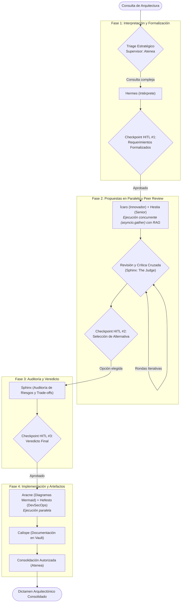

# 🤖 AI-Agent-Assistant & ATENEA

<div align="center">

[](https://www.python.org/)
[](https://fastapi.tiangolo.com/)
[](https://vuejs.org/)
[](https://www.typescriptlang.org/)
[-2EAD33?style=for-the-badge&logo=playwright&logoColor=white>)](https://playwright.dev/)
[-FCC72B?style=for-the-badge&logo=vitest&logoColor=black>)](https://vitest.dev/)
[-0A9EDC?style=for-the-badge&logo=pytest&logoColor=white>)](https://pytest.org/)
[](https://www.docker.com/)
[](https://blog.cleancoder.com/)

**Motor Meta-Agéntico Declarativo y Asistente Técnico Consultivo de Arquitectura de Software**  
_Proyecto de Trabajo Fin de Máster (TFM) — Máster en Desarrollo con Inteligencia Artificial_  
**Autor:** Jesús Jiménez Vaquero ([@txus2202](https://github.com/txus2202))

</div>

---

## 📑 Índice de Contenidos

1. [Visión General: La Dualidad del Sistema](#-1-visión-general-la-dualidad-del-sistema)
2. [ATENEA: El Consejo Virtual de Arquitectura de Software](#️-2-atenea-el-consejo-virtual-de-arquitectura-de-software)
3. [Topología de Deliberación Colegiada (`topology.yaml`)](#-3-topología-de-deliberación-colegiada-topologyyaml)
4. [Funcionalidades Principales: Gobernanza HITL, Voz y Personalización](#-4-funcionalidades-principales-gobernanza-hitl-voz-y-personalización)
5. [Extensibilidad Declarativa y Modularidad de Herramientas](#-5-extensibilidad-declarativa-y-modularidad-de-herramientas)
6. [Stack Tecnológico](#️-6-stack-tecnológico)
7. [Estructura del Proyecto y Arquitectura Limpia](#-7-estructura-del-proyecto-y-arquitectura-limpia)
8. [Seguridad, Gobernanza RBAC y Enfoque Local-First](#️-8-seguridad-gobernanza-rbac-y-enfoque-local-first)
9. [Observabilidad y Métricas en Tiempo Real (Prometheus & Langfuse)](#-9-observabilidad-y-métricas-en-tiempo-real-prometheus--langfuse)
10. [Arnés de Pruebas y Aseguramiento de la Calidad](#-10-arnés-de-pruebas-y-aseguramiento-de-la-calidad)
11. [Guía de Instalación, Configuración y Ejecución](#-11-guía-de-instalación-configuración-y-ejecución)
12. [Licencia y Créditos Académicos](#️-12-licencia-y-créditos-académicos)

---

## 📖 1. Visión General: La Dualidad del Sistema

Este proyecto aborda uno de los desafíos más críticos en el desarrollo de software impulsado por Inteligencia Artificial: **la separación estricta entre el motor de orquestación multi-agente y el dominio de aplicación del asistente**.

Para resolver este problema, la solución se estructura en dos niveles conceptuales y arquitecturales claramente delimitados:

```
┌────────────────────────────────────────────────────────────────────────────────────────┐
│                                  AI-AGENT-ASSISTANT                                    │
│                    (El Framework / Motor Generador Meta-Agéntico)                      │
│                                                                                        │
│  • Clean Architecture Modular (Dominio, Aplicación, Infraestructura, Presentación)     │
│  • Motor de Deliberación Colegiada y Orquestación Asíncrona (Supervisor Pattern)       │
│  • Protocolo Streaming WebSocket bidireccional y Checkpoints Human-in-the-Loop (HITL)  │
│  • Local-First Privacy (ChromaDB Vectorial, Faster-Whisper STT, Kokoro TTS, Vosk WW)   │
│  • Capa Agnóstica Multi-Proveedor LLM (Gemini, OpenAI, Anthropic, Ollama)              │
│  • Arnés Hermético de Pruebas E2E y Unitarias (Playwright + Vitest + Pytest)           │
│                                                                                        │
│                        CONFIGURACIÓN DECLARATIVA (Zero Code)                           │
│                     ┌────────────────────────┬─────────────────────────┐               │
│                     │      agents.yaml       │      topology.yaml      │               │
│                     │  (Catálogo de Agentes) │  (Grafo de Deliberación)│               │
│                     └───────────┬────────────┴────────────┬────────────┘               │
└─────────────────────────────────┼─────────────────────────┼────────────────────────────┘
                                  ▼                         ▼
┌────────────────────────────────────────────────────────────────────────────────────────┐
│                                       ATENEA                                           │
│                       (La Aplicación / Caso de Uso Referencial)                        │
│                                                                                        │
│  • "Asistente Técnica y Evaluadora de Nuevas Estructuras y Arquitecturas"              │
│  • Consejo Virtual de Arquitectura de Software y Equipo de IT Integral:                │
│    - Atenea (Supervisor / Moderador Estratégico)                                       │
│    - Hermes (Intérprete de Lenguaje Natural)                                           │
│    - Ícaro (Arquitecto Innovador y Tecnologías Disruptivas)                            │
│    - Hestia (Arquitecta Senior, Clean Architecture y Estabilidad)                      │
│    - Sphinx (El Juez, Auditor de Riesgos y Evaluación de Trade-offs)                   │
│    - Hefesto (Especialista en DevSecOps, Infraestructura Cloud y Seguridad)            │
│    - Aracne (Diagramadora de Arquitectura en Mermaid en Tiempo Real)                   │
│    - Metis (Aprendizaje Continuo e Ingesta RAG de Fuentes Externas)                    │
│    - Fídias (Generación de Mockups y Artefactos Visuales)                              │
│    - Dédalo (Desarrollador Full-Stack y Maestro Artesano del Software)                 │
│    - Calíope (Documentación Técnica, ADRs y Diapositivas PPTX)                         │
└────────────────────────────────────────────────────────────────────────────────────────┘
```

1. **`ai-agent-assistant` (El Framework)**:  
   Es el **motor meta-agéntico agnóstico al dominio**. Proporciona el ciclo de vida de los agentes, la gestión asíncrona de tareas, la ingesta vectorial RAG, el bus de eventos en streaming por WebSocket, los controles interactivos de supervisión humana (HITL), la personalización multi-usuario en caliente, la pila de modelos de voz locales y el arnés de pruebas automatizado. El motor está completamente desacoplado del dominio mediante el test estático [`test_decoupling_guard.py`](backend/tests/application/agents/test_decoupling_guard.py) (garantizando cero nombres de agentes acoplados en el código).

2. **`ATENEA` (La Aplicación Especializada)**:  
   Es la **instanciación y caso de estudio tecnológico de referencia**. Mediante los archivos declarativos [`agents.yaml`](agents.yaml) y [`topology.yaml`](topology.yaml), configura un equipo virtual completo de ingeniería y arquitectura de software que colabora en deliberación colegiada para diseñar, auditar y documentar sistemas de información de alta complejidad.

> [!NOTE]
> Para profundizar en el marco teórico de la separación entre el Framework y la Aplicación, consulta el documento de arquitectura:  
> 📄 [obsidian_vault/docs/architecture/ai_agent_assistant_vs_atenea_concept.md](obsidian_vault/docs/architecture/ai_agent_assistant_vs_atenea_concept.md)

---

## 🏛️ 2. ATENEA: El Consejo Virtual de Arquitectura de Software

En su instanciación como **A.T.E.N.E.A.** (_Asistente Técnica y Evaluadora de Nuevas Estructuras y Arquitecturas_), el sistema materializa un consejo colegiado de 11 agentes especialistas configurados declarativamente:

| Agente      | Rol en el Grafo Dialéctico          | Especialidad y Misión Técnica                                                                                | Artefacto / Herramienta Asociada                                                                                                                                                                  | RAG |
| :---------- | :---------------------------------- | :----------------------------------------------------------------------------------------------------------- | :------------------------------------------------------------------------------------------------------------------------------------------------------------------------------------------------ | :-: |
| **Atenea**  | **Supervisora y Moderadora**        | Coordinación estratégica del debate, resolución de disensos y redacción del dictamen consolidado.            | Dictamen Arquitectónico Consolidado                                                                                                                                                               | No  |
| **Hermes**  | **Intérprete de Requerimientos**    | Traduce peticiones humanas en lenguaje natural a especificaciones técnicas formales y estructuradas.         | Especificación de Requerimientos                                                                                                                                                                  | No  |
| **Ícaro**   | **Arquitecto Proponente Innovador** | Plantea soluciones vanguardistas, arquitecturas event-driven, reactivas, microservicios y serverless.        | Propuesta Arquitectónica Disruptiva                                                                                                                                                               | Sí  |
| **Hestia**  | **Arquitecta Proponente Senior**    | Defensora de la prudencia, Clean Architecture, DDD, modularidad, mantenibilidad y resiliencia.               | Propuesta Arquitectónica Robusta                                                                                                                                                                  | Sí  |
| **Sphinx**  | **El Juez y Auditor Crítico**       | Análisis crítico de riesgos, estimación de costes, detección de cuellos de botella y balanceo de trade-offs. | Matriz de Riesgos y Evaluación Comparativa                                                                                                                                                        | Sí  |
| **Hefesto** | **Especialista DevSecOps**          | Hardening de seguridad, auditoría de permisos, pipelines CI/CD y contenedorización Cloud-Native.             | Manifiestos Docker, K8s y Directivas DevSecOps                                                                                                                                                    | Sí  |
| **Aracne**  | **Diagramadora de Arquitectura**    | Generación de diagramas técnicos interactivos en Mermaid (C4, secuencia, clases y topologías).               | Diagramas Interactivos SVG ([`DiagramModal.vue`](frontend/src/components/tools/DiagramModal.vue))                                                                                                 | Sí  |
| **Metis**   | **Especialista en Ingesta y RAG**   | Extracción, procesamiento y vectorización de PDFs, documentación técnica y URLs hacia ChromaDB.              | Indexación Vectorial RAG en Obsidian Vault                                                                                                                                                        | Sí  |
| **Fídias**  | **Diseñador Visual de Activos**     | Generación de diagramas de alto nivel, esquemas visuales y mockups de interfaces (HTML5/Imagen).             | Mockups Visuales y Layouts ([`ImageModal.vue`](frontend/src/components/tools/ImageModal.vue))                                                                                                     | No  |
| **Dédalo**  | **Desarrollador Full-Stack**        | Implementación de código funcional, pruebas de concepto (POCs), scripts y arquitecturas web con Clean Code.  | Código Fuente y Scripts ([`CodeModal.vue`](frontend/src/components/tools/CodeModal.vue))                                                                                                          | No  |
| **Calíope** | **Documentadora y Presentaciones**  | Elaboración de actas de decisión (ADRs), minutas en Markdown y diapositivas ejecutivas con exportación PPTX. | Documentos Markdown ([`DocumentModal.vue`](frontend/src/components/tools/DocumentModal.vue)) y Diapositivas PPTX ([`PresentationModal.vue`](frontend/src/components/tools/PresentationModal.vue)) | Sí  |

---

## 🔄 3. Topología de Deliberación Colegiada (`topology.yaml`)

El flujo de trabajo dialéctico está modelado como un grafo acíclico dirigido (DAG) con fases de ejecución en paralelo y puntos de supervisión humana obligatorios:



---

## 🎯 4. Funcionalidades Principales: Gobernanza HITL, Voz y Personalización

### 4.1 Gobernanza Human-In-The-Loop (HITL) y Control por Voz

El operador humano mantiene la gobernanza total del proceso deliberativo en cada punto de control, tanto desde la interfaz gráfica reactiva como mediante comandos de voz contextuales en tiempo real:

| Acción HITL | Payload de Control | Disparadores de Voz (Vosk) | Impacto en la Deliberación |
| :--- | :--- | :--- | :--- |
| **✓ Aceptar** | `decision: "approve"` | _"aceptar"_, _"aprobar"_, _"adelante"_, _"conforme"_, _"de acuerdo"_ | Valida la fase actual y continúa hacia la siguiente etapa de la topología. |
| **✏ Refinar** | `decision: "refine"` | _"refinar"_, _"corregir"_, _"cambiar"_, _"modificar"_, _"ajustar"_ | Reabre la fase actual incorporando feedback en lenguaje natural; activa el micrófono automáticamente. |
| **🔀 Desviar** | `decision: "divert"` | _"desviar"_, _"bifurcar"_, _"derivar"_, _"delegar"_ | Omite las fases intermedias y delega el turno directamente a uno o varios especialistas seleccionados. |
| **📦 Consolidar** | `decision: "consolidate"` | _"consolidar"_, _"consolida"_, _"resumir"_, _"resumen"_ | Concluye el debate de forma anticipada y ordena a Atenea redactar y consolidar el dictamen final con la información acumulada hasta ese punto. |
| **🛑 Finalizar** | `decision: "finish"` | _"finalizar"_, _"terminar"_, _"detener"_, _"parar"_, _"concluir"_, _"fin"_ | Detiene y da por finalizado el debate de inmediato en seco, **sin realizar consolidación** ni generar dictamen final. |
| **🔄 Reintentar** | `decision: "retry"` | _"reintentar"_, _"reintenta"_, _"repetir"_, _"repite"_ | Reejecuta la fase actual para los agentes seleccionados sin avanzar en la topología. |
| **✗ Rechazar** | `decision: "reject"` | _"rechazar"_, _"denegar"_, _"cancela"_, _"cancelar"_, _"descartar"_ | Descarta la propuesta actual y fuerza una re-ejecución con alternativas diferentes. |

- **Interrupción Inmediata de Voz (Barge-In)**: Cualquier interacción (clic o comando) detiene instantáneamente la síntesis de voz en reproducción (`stopTts()`).
- **Comando Universal de Silencio**: Disponible en todo momento diciendo _"silencio"_, _"silenciar"_, _"calla"_ o _"cállate"_.
- **Selección Contextual de Agentes**: Al pronunciar el nombre de un especialista durante un checkpoint HITL (p. ej. _"Hestia"_), el sistema lo conmuta en la lista de destinatarios para la acción de desvío.

### 4.2 Personalización Multi-Usuario, Memoria RAG en Caliente e Historial

Además de la deliberación base definida por el administrador del sistema, cada operador autenticado dispone de capacidades avanzadas de personalización aisladas por usuario (`user_id`):

- **Topología de Debate Personalizable por Usuario (`/topology`)**: Permite a cada usuario adaptar desde la interfaz gráfica ([`TopologyView.vue`](frontend/src/views/TopologyView.vue)) qué especialistas intervienen en cada fase (`interpreters`, `proposers`, `reviewers`, `evaluators`, `implementers`) y cuántas rondas iterativas de crítica cruzada (`review_rounds` de `0` a `5`) se ejecutan antes del checkpoint humano. Mantiene el rol de **Supervisor inmutable**, aplica auto-saneado automático si un agente se retira de `agents.yaml` y ofrece restablecimiento inmediato a los valores globales de `topology.yaml`.
- **Selección Individual de Modelos LLM y Sonda Dinámica**: Cada agente puede asignarse en caliente a un proveedor y modelo distinto (Gemini, OpenAI, Anthropic u Ollama local). Una sonda verificadora consulta los modelos realmente soportados por cada API key y los almacena en una caché SQLite compartida para minimizar latencias y llamadas redundantes.
- **Ajuste de Hiperparámetros RAG en Tiempo Real**: Control directo mediante deslizadores en cada tarjeta de agente sobre el volumen de fragmentos recuperados (`Chunks` / `RAG_TOP_K`) y el umbral mínimo de similitud coseno (`Proximidad` / `RAG_MIN_SCORE`), sin reiniciar el backend.
- **Aprendizaje Continuo Multimodal y Memoria Persistente**: Ingesta bajo demanda de documentos PDF, páginas web (URLs) y notas Markdown hacia ChromaDB y `obsidian_vault/learned/`, sumada a un **Historial Reactivo de Debates (`/history`)** aislado por cuenta que permite retomar, inspeccionar o auditar deliberaciones previas y sus artefactos generados.
- **Aplicación Web Progresiva (PWA) Instalable Multi-Plataforma**: Instalable como aplicación nativa independiente (`display: standalone`) en macOS, Windows, Linux, Android e iOS mediante [`manifest.webmanifest`](frontend/public/manifest.webmanifest), iconos adaptativos (`maskable`) y Service Worker ([`sw.js`](frontend/public/sw.js)) con frontera estricta `Network-Only` para `/api/*` y `/ws/*` (cero fugas de caché multi-tenant) y botón progresivo de instalación en el menú de operador.

---

## 🧩 5. Extensibilidad Declarativa y Modularidad de Herramientas

La arquitectura del motor **`ai-agent-assistant`** está diseñada bajo el principio _Open/Closed_ (abierto a la extensión, cerrado a la modificación): permite generar un asistente para cualquier otro sector (auditoría legal, medicina, finanzas, educación) **sin tocar una sola línea de código** y extender la interfaz gráfica mediante herramientas especializadas.

### 5.1 Definición Declarativa de Asistentes y Topologías

Para crear un nuevo asistente o modificar el comportamiento base de Atenea, solo es necesario parametrizar dos archivos en la raíz:

1. **[`agents.yaml`](agents.yaml)**: Catálogo de especialistas, sus system prompts, herramientas asignadas, proveedores/modelos por defecto, flags RAG y alias fonéticos para el motor de voz.
2. **[`topology.yaml`](topology.yaml)**: Grafo de deliberación por defecto que asigna qué agentes asumen los roles de `supervisor`, `interpreters`, `proposers`, `reviewers`, `evaluators` e `implementers`, así como el número declarativo de `review_rounds`.

El test automatizado estático [`test_decoupling_guard.py`](backend/tests/application/agents/test_decoupling_guard.py) audita continuamente el repositorio para asegurar que ningún nombre de agente de Atenea se filtre o quede acoplado en las capas internas del framework.

### 5.2 Arquitectura Modular de Herramientas en el Frontend (`frontend/src/components/tools/`)

A diferencia de los asistentes conversacionales estándar que devuelven bloques de texto monolíticos, ATENEA desacopla los tipos de artefactos técnicos generados mediante un **subsistema modular de modales interactivos** en [`frontend/src/components/tools/`](frontend/src/components/tools/):

- **[`CodeModal.vue`](frontend/src/components/tools/CodeModal.vue) (Dédalo - Código y POCs)**: Visor de código fuente con resaltado de sintaxis multilenguaje, numeración de líneas, botón de copiado rápido con confirmación háptica y descarga directa del archivo con la extensión correspondiente.
- **[`DiagramModal.vue`](frontend/src/components/tools/DiagramModal.vue) (Aracne - Diagramas Mermaid)**: Renderizador interactivo en tiempo real de diagramas SVG con controles de zoom dinámico (rueda de ratón o botones), desplazamiento táctil o por arrastre (pan), visualización a pantalla completa y exportación vectorial a `.svg`.
- **[`DocumentModal.vue`](frontend/src/components/tools/DocumentModal.vue) (Calíope - Minutas y ADRs)**: Visor tipográfico de especificaciones técnicas, actas de deliberación y Registros de Decisiones de Arquitectura (ADRs) con soporte para formato GitHub Flavored Markdown (GFM).
- **[`PresentationModal.vue`](frontend/src/components/tools/PresentationModal.vue) (Calíope - Diapositivas y PPTX)**: Reproductor de presentaciones en modo proyector con navegación por teclado/swipe táctil, vista en cuadrícula de miniaturas y exportador binario cliente a presentaciones de Microsoft PowerPoint (`.pptx`) utilizando la librería `PptxGenJS`.
- **[`ImageModal.vue`](frontend/src/components/tools/ImageModal.vue) (Fídias - Mockups y Gráficos)**: Visor de alta resolución para esquemas visuales, wireframes generativos y prototipos de interfaces.

> **Extensibilidad de la UI**: Añadir un nuevo tipo de entregable (p. ej., tablas financieras interactivas o visores de métricas) no requiere modificar el núcleo del chat ni el bus WebSocket: basta con crear un nuevo componente modal en `frontend/src/components/tools/` y registrar su trigger.

---

## 🛠️ 6. Stack Tecnológico

El sistema combina tecnologías modernas de alto rendimiento priorizando tipado estricto, ejecución asíncrona no bloqueante y soberanía de datos en local:

| Capa Arquitectónica | Tecnologías y Librerías Clave | Rol en el Sistema |
| :--- | :--- | :--- |
| **Backend & Core** | Python 3.12+ (compatible hasta 3.14), FastAPI, Uvicorn, Pydantic v2, `uv` | API REST asíncrona, canales WebSocket full-duplex, validación estricta de esquemas y gestión determinista de dependencias (`uv.lock`). |
| **IA & Multi-LLM** | Motor _Supervisor Pattern_ propio (`asyncio`), `google-genai` (Gemini / Vertex AI), `openai`, `anthropic`, Ollama / OpenAI-compatible, Google Imagen | Orquestación dialéctica paralela sin acoplamiento a frameworks pesados, abstracción multi-proveedor en caliente y generación visual. |
| **Memoria Vectorial & RAG** | ChromaDB (embebido o servidor), `sentence-transformers` (`all-MiniLM-L6-v2`), PyMuPDF, BeautifulSoup4, Obsidian Vault | Embeddings locales en CPU (coste cero de API), búsqueda semántica filtrada por metadatos e ingesta multimodal (Markdown, PDF, Web). |
| **Audio Multimodal Local** | `faster-whisper` (STT), `kokoro-onnx` (TTS neural), `vosk` (_Wake-Word_) | Transcripción de voz, síntesis neural de baja latencia y escucha continua de comandos HITL 100% en local. |
| **Frontend & Visualización** | Vue 3.5 (Composition API), TypeScript, Vite 8, PWA (`manifest.webmanifest` + Service Worker), Pinia 4, Vue Router 5, Tailwind CSS 4, Mermaid 12, PptxGenJS, DOMPurify | SPA/PWA instalable multi-plataforma con _App Shell_ offline, gestión centralizada de estado, diagramas SVG interactivos, exportación nativa a `.pptx` y sanitización XSS. |
| **Persistencia & Seguridad** | SQLite (modo WAL) / PostgreSQL, `argon2-cffi` (Argon2id), `PyJWT` (`HMAC-SHA256`), Telegram Bot API | Almacenamiento relacional multi-tenant aislado por `user_id`, sesiones seguras en cookies `HttpOnly` y alertas de auditoría en tiempo real. |
| **Observabilidad & DevOps** | Langfuse v3 (ClickHouse, MinIO, Redis, Postgres), Prometheus (`prometheus-client`), Netdata, Docker Compose, GitHub Actions | Trazabilidad completa de árboles de debate/costes LLM, telemetría operacional OpenMetrics, despliegue aislado por perfiles y CI/CD. |
| **Calidad & Testing** | Pytest (`pytest-asyncio`), Vitest, Playwright, Ruff, Mypy, Oxlint, ESLint | Arnés hermético de 1.142 pruebas automatizadas (unitarias, integración y E2E multi-dispositivo) y análisis estático estricto. |

---

## 📂 7. Estructura del Proyecto y Arquitectura Limpia

El monorepo sigue de forma estricta los principios de **Clean / Hexagonal Architecture (Ports & Adapters)**. La regla de dependencia apunta siempre hacia el interior (`Presentation / Infrastructure ──▶ Application ──▶ Domain`), auditada automáticamente mediante análisis AST en cada ejecución de pruebas:

```text
ai-agent-assistant/
├── agents.yaml                  # Catálogo declarativo de agentes (prompts, modelos, RAG, fonética)
├── topology.yaml                # Topología dialéctica por defecto y rondas de revisión (DAG)
├── docker-compose.yml           # Orquestación multi-perfil (local, scale, observability, full)
├── .env.example                 # Plantilla documentada de variables de entorno
│
├── backend/                     # Motor Meta-Agéntico en Python (Clean Architecture)
│   ├── pyproject.toml           # Definición del proyecto, linters (Ruff/Mypy) y dependencias
│   ├── uv.lock                  # Lockfile determinista de dependencias Python
│   ├── voices/                  # Pesos locales de síntesis neural Kokoro ONNX (descargados)
│   ├── src/
│   │   ├── domain/              # Capa de Dominio Puro (0 dependencias externas)
│   │   │   ├── entities/        # Entidades de negocio (Agent, Task, User, DebateSession)
│   │   │   ├── value_objects/   # Objetos de valor inmutables (SearchFilter, UserTopologyConfig)
│   │   │   ├── agents/          # Contratos de perfiles y grafo DebateTopology
│   │   │   └── ports/           # Interfaces abstractas (LLM, RAG, Audio, Auth, Métricas, Repos)
│   │   ├── application/         # Capa de Aplicación y Orquestación
│   │   │   ├── agents/          # SupervisorAgent, SubAgentRunner y fases dialécticas
│   │   │   ├── services/        # Servicios de dominio/aplicación (Auth, UserTopology, Vault)
│   │   │   └── use_cases/       # Casos de uso (IngestVault, QueryVault, LearnFromSource)
│   │   ├── infrastructure/      # Adaptadores Técnicos Concretos
│   │   │   ├── llm/             # Clientes Gemini, OpenAI, Anthropic y Local/Ollama
│   │   │   ├── rag/             # ChromaDocumentStore y embeddings Sentence-Transformers
│   │   │   ├── persistence/     # Repositorios SQLite y PostgreSQL (usuarios, debates, topología)
│   │   │   ├── audio/           # Servicios locales Faster-Whisper, Kokoro-ONNX y Vosk
│   │   │   ├── security/        # Hasher Argon2id, JWT Token Service y alertas Telegram
│   │   │   ├── observability/   # Adaptadores Langfuse, Prometheus/OpenMetrics y DockerManager
│   │   │   ├── learning/        # Extractores documentales (PDF con PyMuPDF, Web/HTML, Texto)
│   │   │   ├── image_generation/# Proveedores de generación visual (Google Imagen)
│   │   │   └── config/          # Cargadores declarativos YAML (agents.yaml y topology.yaml)
│   │   └── presentation/        # Capa de Entrada HTTP / WebSocket (FastAPI)
│   │       └── api/             # App factory, rutas REST (/api/*), dependencias DI y WS (/ws/*)
│   └── tests/                   # Suite Pytest espejando domain/, application/, infrastructure/ y api/
│
├── frontend/                    # Aplicación Web Reactiva / PWA (Vue 3 + TypeScript + Vite)
│   ├── public/                  # Activos estáticos, manifest.webmanifest, sw.js e iconos PWA
│   ├── src/
│   │   ├── views/               # Vistas de página (HomeView, TopologyView, HistoryView, Auth)
│   │   ├── components/          # UI reactiva, tarjetas de agente, panel HITL, gestión de usuarios
│   │   │   └── tools/           # Modales modulares (Code, Diagram, Document, Presentation, Image)
│   │   ├── stores/              # Estado reactivo Pinia (debate, auth, voice, history)
│   │   ├── services/            # Clientes tipados REST y WebSocket
│   │   ├── composables/         # Lógica reutilizable (audio PCM, TTS, instalación PWA, atajos)
│   │   ├── pwa/                 # Registro seguro de Service Worker en producción
│   │   └── router/              # Rutas y guardias de navegación (setup, auth, roles)
│   └── e2e/                     # Suite End-to-End con Playwright (Desktop Chromium + Mobile)
│
├── obsidian_vault/              # Segundo Cerebro (Base de Conocimiento RAG + SDD)
│   ├── ARCHITECTURE.md          # Diseño arquitectónico detallado del sistema
│   ├── DECISIONS.md             # Registro histórico de Decisiones de Arquitectura (ADRs 001–027)
│   ├── docs/features/           # Especificaciones técnicas Spec-Driven Development (SDD)
│   ├── deliberations/           # Actas consolidadas generadas por el consejo
│   └── learned/                 # Conocimiento ingerido dinámicamente por Metis
│
└── scripts/                     # Utilidades operativas y automatización
    ├── download_models.sh       # Descarga y verificación SHA-256 de modelos Kokoro y Vosk
    ├── ingest_vault.py          # Script CLI de indexación inicial del Obsidian Vault
    └── start.sh                 # Arranque unificado de desarrollo (Backend + Frontend + Langfuse)
```

---

## 🛡️ 8. Seguridad, Gobernanza RBAC y Enfoque Local-First

- 🔒 **Soberanía y Privacidad Total**: El conocimiento empresarial almacenado en el Obsidian Vault se indexa exclusivamente en local mediante **ChromaDB** y embeddings en CPU. Ningún fragmento de documentación interna se envía a terceros para su vectorización ni se cruza entre cuentas no autorizadas.
- 🗣️ **Modelos de Audio Locales Verificados**:
  - **Faster-Whisper**: Transcripción de voz (STT) ejecutada íntegramente en local.
  - **Kokoro ONNX**: Síntesis de voz neural (TTS) de baja latencia sin consumo de APIs externas.
  - **Vosk**: Reconocimiento continuo de palabras de activación (_wake words_) en segundo plano, con verificación criptográfica de integridad (`SHA-256`) en la descarga de modelos.
- 🛡️ **Aislamiento Multi-Tenant, RBAC y Alertas Activas**:
  - Autenticación sin credenciales por defecto mediante asistente de registro inicial (`/setup`), contraseñas hasheadas con **`Argon2id`** (`argon2-cffi`) y sesiones **`JWT` (`HMAC-SHA256`)** transportadas en cookies `HttpOnly` / `SameSite`.
  - Control de acceso basado en roles (`admin` y `user`) con panel integrado de administración de cuentas ([`UserManagementModal.vue`](frontend/src/components/UserManagementModal.vue)), aislamiento por `user_id` en SQLite/PostgreSQL y limitación de tasa (_rate limiting_) contra fuerza bruta.
  - **Alertas de Seguridad en Telegram**: Notificación asíncrona opcional en tiempo real ante inicios de sesión, fallos repetidos o bloqueos por _rate limit_.
- 🌐 **Endurecimiento de Red y Protección Anti-Indexación**: Contenedores sin privilegios (`cap_drop: ALL`, `no-new-privileges`), red de datos interna aislada (`internal: true`) y triple barrera anti-rastreo (`noindex, nofollow` en HTML, denegación en `robots.txt` y cabecera `X-Robots-Tag` en Nginx).

---

## 📊 9. Observabilidad y Métricas en Tiempo Real (Prometheus & Langfuse)

El sistema implementa una arquitectura dual de observabilidad desacoplada para garantizar visibilidad operacional y trazabilidad técnica:

1. **Trazabilidad Dialéctica con Langfuse**:
   - Captura árboles de ejecución, razonamiento de agentes, rondas de consenso y auditoría de tokens/costes por modelo LLM.
2. **Telemetría Operacional con Prometheus (OpenMetrics)**:
   - Expone métricas en formato estándar en el endpoint `GET /metrics` de FastAPI.
   - Diseñado bajo arquitectura hexagonal (`IMetricsService` y `PrometheusMetricsService`) con garantías **fail-safe** (el reporte de telemetría nunca interrumpe el flujo de negocio).
   - Compatible para **auto-descubrimiento en Netdata**, Grafana o cualquier recolector compatible con OpenMetrics.
   - **Activación configurable**: Gobernado por la variable de entorno `METRICS_ENABLED` (activada por defecto, `true`; si se establece en `false`, conmuta a `NoOpMetricsService` sin coste de CPU ni exposición del endpoint).

### Catálogo de Métricas Clave

| Métrica | Tipo | Etiquetas (Labels) | Propósito y Valor Operacional |
| :--- | :--- | :--- | :--- |
| `http_requests_total` | Counter | `method`, `handler`, `status` | Volumen de peticiones y códigos de estado HTTP (2xx, 4xx, 5xx). |
| `http_request_duration_seconds` | Histogram | `handler`, `method` | Latencias percentiles (p50, p90, p99) de endpoints REST. |
| `atenea_websocket_active_connections` | Gauge | `channel` (`debate`, `voice`) | Conexiones WebSocket concurrentes abiertas (previene fugas de sockets). |
| `atenea_stt_transcription_seconds` | Histogram | `model` | Tiempo de transcripción de Faster-Whisper en CPU (Intel N100). |
| `atenea_tts_synthesis_seconds` | Histogram | `voice` | Tiempo de síntesis de voz con Kokoro-ONNX. |
| `atenea_wake_word_detections_total` | Counter | `model` | Activaciones de la palabra clave por voz (Vosk). |
| `atenea_rag_query_duration_seconds` | Histogram | `collection` | Latencia de búsqueda vectorial por similitud en ChromaDB. |
| `atenea_learning_notes_saved_total` | Counter | `status` (`success`, `error`) | Notas consolidadas persistidas en el Obsidian Vault. |
| `atenea_auth_failed_logins_total` | Counter | `reason` | Detección temprana de intentos fallidos de autenticación y fuerza bruta. |

---

## 🧪 10. Arnés de Pruebas y Aseguramiento de la Calidad

El sistema cuenta con un arnés de pruebas automatizado (_Test Harness_) integral de **1.142 pruebas automatizadas pasando con éxito (100% pass rate)** que garantiza la estabilidad del software con **coste cero en consumo de tokens**:

1. **Suite End-to-End con Playwright (42/42 tests pasando)**:
   - Ejecutados en navegadores reales: Chromium (Escritorio `1280x720`) y Mobile Chrome (Pixel 7).
   - Valida el flujo dialéctico completo: autenticación y setup inicial, instalabilidad PWA (`manifest.webmanifest`, iconos y acción progresiva), gestión RBAC de usuarios, streaming por WebSockets, personalización de modelos/RAG y topología por usuario (`/topology`), checkpoints HITL con todas sus variantes, modales de presentaciones PPTX, diagramas interactivos Mermaid con zoom/pan, visor de código e historial reactivo de debates.
2. **Suite Unitaria y de Componentes Frontend (469/469 tests en Vitest)**:
   - Cobertura exhaustiva de vistas y componentes Vue 3, composables reactivos, utilidades de parsing y stores centralizados Pinia con mocks deterministas de WebSocket y APIs REST.
3. **Suite de Backend e Integración (631/631 tests en Pytest)**:
   - Pruebas asíncronas con `ASGITransport` cubriendo entidades y servicios de dominio, orquestación del Supervisor, repositorios SQLite/PostgreSQL, aislamiento por usuario, embeddings de ChromaDB, validación Pydantic, seguridad JWT/Argon2id y adaptadores LLM.
4. **Calidad de Código, Tipado Estricto y Desacoplamiento Arquitectónico**:
   - `vue-tsc --build` + `mypy`: 0 errores de tipado estricto en TypeScript y Python.
   - `oxlint` + `eslint` + `ruff`: 0 errores y 0 advertencias de linter.
   - [`test_decoupling_guard.py`](backend/tests/application/agents/test_decoupling_guard.py): Auditoría estática (21 reglas AST) que verifica que el código del motor no contenga referencias codificadas a los nombres de agentes de la aplicación ni violaciones de capas de Clean Architecture.

---

## 🚀 11. Guía de Instalación, Configuración y Ejecución

### Requisitos Previos

- **Python 3.12+** (probado en Python 3.12 y 3.14) y gestor **[`uv`](https://docs.astral.sh/uv/)** (recomendado para reproducibilidad exacta mediante `uv.lock`).
- **Node.js 22.18+ o 24+** y `npm`.
- **Docker y Docker Compose** (necesario para la Opción A o para levantar la pila local de observabilidad Langfuse).

### 1. Descarga de Modelos de Voz Locales

Para garantizar la privacidad, los motores de síntesis y activación por voz operan en tu propia máquina. Descárgalos y verifica sus sumas criptográficas `SHA-256` ejecutando:

```bash
chmod +x scripts/download_models.sh
./scripts/download_models.sh
```

_(Descarga los pesos de Kokoro ONNX TTS en `backend/voices/` y el modelo `vosk-model-small-es-0.42` en `backend/src/infrastructure/models/vosk/`)_.

### 2. Configuración de Variables de Entorno (`.env`)

Crea tu archivo `.env` en la raíz del proyecto a partir de la plantilla:

```bash
cp .env.example .env
```

Edita `.env` según el modo de ejecución elegido:

1. **Proveedores LLM**: Descomenta y añade al menos una clave de API (`GEMINI_API_KEY`, `OPENAI_API_KEY` o `ANTHROPIC_API_KEY`), o configura `LOCAL_LLM_BASE_URL=http://localhost:11434` para usar modelos locales con Ollama.
2. **Despliegue en local sin Docker (Opciones B y C)**: No requiere secretos adicionales; si `AUTH_SECRET_KEY` está comentada, el backend genera automáticamente una clave efímera para desarrollo local.
3. **Despliegue con Docker Compose (Opción A)**:
   - Descomenta `AUTH_SECRET_KEY` y asígnale un secreto persistente (p. ej. `openssl rand -base64 48`).
   - En `.env.example`, la variable `COMPOSE_PROFILES=observability` viene activa por defecto. Para una **evaluación rápida del núcleo (`backend` + `frontend`)** deja `COMPOSE_PROFILES=` vacío; si deseas levantar también la pila completa autoalojada de Langfuse (`observability`, `scale` o `full`), descomenta y define las credenciales de infraestructura indicadas en la sección _Observability & Infrastructure Stack Credentials_ de `.env`.

### 3. Arranque del Sistema

#### Opción A: Despliegue con Docker Compose (Aislado en Contenedores)

Levanta los servicios configurados con aislamiento de red, volúmenes persistentes y _healthchecks_ automáticos:

```bash
# Arranque según el perfil definido en COMPOSE_PROFILES dentro de .env
docker compose up -d

# O especificando explícitamente un perfil (local | observability | scale | full):
docker compose --profile observability up -d
```

#### Opción B: Script Local Unificado (Recomendado para Desarrollo)

Crea e instala automáticamente `.venv` (si `uv` está disponible) y `node_modules` si aún no existen, y levanta coordinadamente el backend FastAPI y el frontend Vite:

```bash
./scripts/start.sh

# Opcional: arrancar simultáneamente los contenedores de trazabilidad Langfuse
./scripts/start.sh --with-langfuse
```

#### Opción C: Ejecución Manual en Dos Terminales

1. **Terminal 1 — Backend (FastAPI):**
   ```bash
   cd backend
   uv sync --frozen --extra dev
   uv run --no-sync uvicorn src.presentation.api.app:app --reload --host 0.0.0.0 --port 8000
   ```
   _(Opcional: para pre-indexar la documentación inicial del Obsidian Vault antes del primer debate, ejecuta desde `backend/`: `uv run --no-sync python ../scripts/ingest_vault.py`)_.

2. **Terminal 2 — Frontend (Vue 3 / Vite):**
   ```bash
   cd frontend
   npm ci
   npm run dev
   ```

### 4. Primer Acceso y Registro Inicial (`/setup`)

Por seguridad (**Zero Default Credentials**), el sistema nace sin usuarios preconfigurados. Al abrir por primera vez [http://localhost:5173](http://localhost:5173), la aplicación redirigirá automáticamente al asistente **`/setup`** para crear la cuenta administradora inicial. Una vez creada, dicho endpoint queda bloqueado permanentemente y los usuarios adicionales se gestionan desde el panel de administración.

### 5. Ejecución del Arnés de Pruebas y Calidad

Desde la carpeta `backend/`:

```bash
# Ejecutar las 631 pruebas unitarias, de integración y guarda arquitectónica AST
uv run --no-sync pytest tests/ -v
```

Desde la carpeta `frontend/`:

```bash
# Ejecutar las 469 pruebas unitarias y de componentes (Vitest)
npm run test:unit

# Ejecutar las 42 pruebas End-to-End multi-navegador (Playwright: Desktop + Mobile)
npm run test:e2e

# Verificar tipado estricto y linters (0 errores / 0 warnings)
npm run type-check && npm run lint
```

### 6. Servicios y Endpoints Disponibles

- **Interfaz de Usuario (ATENEA)**: [http://localhost:5173](http://localhost:5173)
- **API Backend y Documentación OpenAPI (Swagger)**: [http://localhost:8000/docs](http://localhost:8000/docs)
- **Healthcheck del Backend**: [http://localhost:8000/health](http://localhost:8000/health)
- **Métricas Prometheus / OpenMetrics**: [http://localhost:8000/metrics](http://localhost:8000/metrics)
- **Panel de Observabilidad Langfuse** _(con perfil `observability` / `full`)_: [http://localhost:3000](http://localhost:3000)

---

## 🏛️ 12. Licencia y Créditos Académicos

Este proyecto ha sido desarrollado como **Trabajo Fin de Máster (TFM)** en el **Máster en Desarrollo con Inteligencia Artificial**.

- **Autor:** Jesús Jiménez Vaquero ([@txus2202](https://github.com/txus2202))
- **Repositorio:** [https://github.com/txus2202/ai-agent-assistant](https://github.com/txus2202/ai-agent-assistant)
- **Licencia:** Propietaria / Todos los derechos reservados — _Uso exclusivo para Evaluación Académica (TFM)_. Consulta el archivo [LICENSE](LICENSE) para más detalles.
