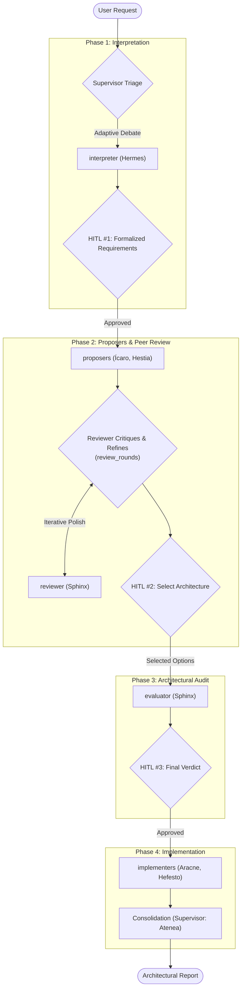

# 🤖 AI Agent Assistant

**AI Agent Assistant** is an advanced Artificial Intelligence agent system designed to assist in the design, evaluation, and documentation of software architectures. Developed as a Master's Thesis, this project stands out for its strict focus on **enterprise data privacy** and the implementation of **Clean Architecture**.

The system acts as a team of experts orchestrated under the **Supervisor Pattern**, interacting seamlessly with a local knowledge base (Obsidian) and keeping the core code and business logic completely decoupled from the underlying AI framework.

## ✨ Key Features

- 🔒 **Total Privacy (Local-First):** LLM integration via secure APIs (Gemini Enterprise) and 100% local execution for both the vector database (ChromaDB) and voice models. No sensitive corporate data ever leaks to public clouds.
- 🧠 **Multimodal RAG with Obsidian:** Capable of reading, vectorizing, and understanding both Markdown text files (`.md`) and locally stored architectural diagrams. The system continuously learns by saving its finalized solutions back into the _Vault_.
- 🗣️ **Voice Interaction (STT/TTS):** Hands-free system control via voice commands processed locally using `Whisper.cpp`, with responses naturally synthesized by `Piper`.
- 🏗️ **Clean Architecture & TDD:** Highly testable modular monolithic design. The application's core domain does not depend on any external AI frameworks (like Google ADK) or infrastructure libraries.
- ⚡ **Real-Time Streaming:** A FastAPI backend communicating via WebSockets with a Vue 3 SPA to stream the agent's reasoning process and output tokens live.

## 🛠️ Tech Stack

- **Frontend:** Vue 3 + TypeScript
- **Backend:** Python (FastAPI)
- **AI Orchestration:** Google ADK (Agent Development Kit)
- **Vector DB & Observability:** ChromaDB + Langfuse (Docker)
- **Local Audio Models:** Faster-Whisper (STT) + Kokoro ONNX (TTS) + Vosk (Wake Word)

## 🚀 Getting Started

### 1. Download Local AI Models

Because this system runs voice processing locally to ensure privacy, you must download the necessary AI models before running the backend. We provide a convenient script to do this:

```bash
# Make sure you are in the root directory
chmod +x scripts/download_models.sh
./scripts/download_models.sh
```

*This will download the Kokoro ONNX TTS model and the Vosk Wake Word model into the appropriate `backend/` directories. (Total size ~380MB)*

### 2. Environment Configuration (`.env`)

Copy the template configuration file and configure your API keys:

```bash
cp .env.example .env
```

#### 📊 Observability Toggle (`LANGFUSE_METRICS_ENABLED`)
The full observability stack (Docker containers and backend telemetry) is controlled dynamically via:

```env
# Set to 'true' to launch Docker containers and collect metrics/traces
# Set to 'false' to run in lightweight local mode without Docker
LANGFUSE_METRICS_ENABLED=true
```

- **When `true`:** The backend's FastAPI lifespan automatically orchestrates the Docker stack (`docker compose up -d`) with Postgres, ClickHouse, Redis, MinIO, and Langfuse Web/Worker. The frontend enables the Langfuse Dashboard link.
- **When `false`:** Docker is kept off (or stopped) to save system resources, telemetries are gracefully bypassed with zero overhead, and the UI button is hidden.

### 3. Launching the System

You can run Atenea using either the unified startup script or separate development terminals:

#### 🟢 Option A: Unified Startup Script (Recommended)
Runs Backend, Frontend, and manages Docker in a single command, with clean shutdown on `Ctrl+C`:

```bash
./scripts/start.sh
```

#### 🟡 Option B: Manual Two-Terminal Setup (Development Mode)
If you want independent logs for backend and frontend:

**Terminal 1 — Backend & Docker Orchestration:**
```bash
cd backend
source .venv/bin/activate
uvicorn src.presentation.api.app:app --reload
```

**Terminal 2 — Frontend (Vue 3 / Vite):**
```bash
cd frontend
npm run dev
```

### 4. Available Services & Endpoints

Once started, the following services will be available:

| Service | URL | Condition |
| :--- | :--- | :--- |
| **Frontend UI (Atenea)** | [http://localhost:5173](http://localhost:5173) | Always Active |
| **Backend API & Swagger Docs** | [http://localhost:8000/docs](http://localhost:8000/docs) | Always Active |
| **Langfuse Telemetry Dashboard** | [http://localhost:3000](http://localhost:3000) | Active when `LANGFUSE_METRICS_ENABLED=true` |
| **MinIO Console (S3 Storage)** | [http://localhost:9091](http://localhost:9091) | Active when `LANGFUSE_METRICS_ENABLED=true` |

---

## 🏛️ Multi-Agent Architecture & Debate Topology (`topology.yaml`)

The system implements a structured collegiate deliberation process orchestrated by a supervisor agent. Rather than hardcoding agent names into the orchestration workflow, the council is decoupled via a declarative **Debate Topology** defined in [`topology.yaml`](file:///Users/jesusjimenezvaquero/Documents/WS/ai-agent-assistant/topology.yaml) at the project root.

### 1. Functional Roles and Debate Phases

The collegiate debate workflow is structured into abstract functional slots:



- **`supervisor` (Orchestrator):** The strategic leader and triage coordinator. Holds final authority and synthesizes the collegiate consensus.
- **`interpreter` (Phase 1):** Translates ambiguous, conversational user requests into strict technical specifications (default: `Hermes`).
- **`proposers` (Phase 2):** Generates architectural alternatives (default: `Ícaro` for bleeding-edge innovation, `Hestia` for operational stability).
- **`reviewer` (Phase 2):** Performs internal peer-review during pre-deliberation before the user is interrupted (default: `Sphinx`).
- **`evaluator` (Phase 3):** Impartial auditor providing critical risk analysis, consistency checks, and architectural verdicts (default: `Sphinx`).
- **`implementers` (Phase 4):** Parallel specialists generating Mermaid diagrams (`Aracne`) and infrastructure/DevSecOps code (`Hefesto`).

### 2. External Agent Catalog (`agents.yaml`) & Dynamic Registry

Agent definitions are 100% decoupled from Python code. All agent profiles—including the strategic supervisor orchestrator—are defined declaratively in [`agents.yaml`](file:///Users/jesusjimenezvaquero/Documents/WS/ai-agent-assistant/agents.yaml) at the project root (overridable via the `AGENTS_FILE` environment variable). The catalog must define at least one supervisor agent (`is_supervisor: true`).

Every profile (`SubAgentProfile`) specifies its metadata, behavior flags, and RAG configuration:

```python
@dataclass(frozen=True)
class SubAgentProfile:
    id: str
    display_name: str
    description: str
    color_hex: str
    system_prompt: str
    uses_rag: bool = False
    rag_filter: SearchFilter | None = None
    phonetic_aliases: tuple[str, ...] = ()
    supports_hitl: bool = True
    is_supervisor: bool = False         # True ONLY for supervisor orchestrators
    can_ingest_documents: bool = False  # True for agents handling document ingestion (e.g. learning)
```

Example `./agents.yaml` entry:

```yaml
version: "1.0"
agents:
  - id: "senior_architect"
    display_name: "Hestia"
    description: "Guardiana de la prudencia arquitectónica y resiliencia operativa"
    color_hex: "#EA580C"
    system_prompt: "Eres Hestia..."
    uses_rag: true
    rag_filter:
      type: "adr"
      status: "approved"
    phonetic_aliases:
      - "hestia"
      - "estia"
    supports_hitl: true
    is_supervisor: false
    can_ingest_documents: false
```

New agents can be registered or removed dynamically at runtime or by editing `agents.yaml` without changing a single line of Python:
```python
from src.domain.agents.sub_agent_profiles import register_profile, unregister_profile

register_profile(my_custom_agent)
```

When `DebateTopology.validate()` parses the topology, it strictly enforces that whichever agent is declared under `supervisor` must have `is_supervisor=True`. Attempting to set an operational specialist as the supervisor will raise a `ValueError` immediately at load time.

### 3. Declarative Topology (`topology.yaml`)

You can customize council members, adjust team composition, or change the number of peer-review rounds by editing `./topology.yaml` in the project root:

```yaml
version: "1.0"

# Main strategic orchestrator (must have is_supervisor=True in profile)
supervisor: "Atenea"

# Phase 1: Natural Language Requirement Formalization
interpreter: "Hermes"

# Phase 2: Architecture Solution Proposers & Peer Review
proposers:
  - "Ícaro"
  - "Hestia"

reviewer: "Sphinx"

# Number of internal review iterations between Reviewer and Proposers before HITL
review_rounds: 1

# Phase 3: Architectural Audit & Verdict
evaluator: "Sphinx"

# Phase 4: Technical Implementation, Diagramming & DevSecOps
implementers:
  - "Aracne"
  - "Hefesto"
```

### 4. Configuration Precedence

The number of internal peer-review rounds (`review_rounds`) follows this strict precedence hierarchy:

1. **Direct Parameter Injection:** `SupervisorAgent.run(..., review_rounds=N)`
2. **Explicit Topology Object:** Injected `DebateTopology(..., review_rounds=N)`
3. **Environment Variable:** `REVIEW_ROUNDS=N` in `.env` (overrides file configuration for cloud-native deployment)
4. **File Configuration:** `review_rounds` specified in `./topology.yaml`
5. **Fallback Default:** `1` round

### 5. Development Methodology (SDD & TDD) & Decoupling Guard

This feature was designed and delivered following **Specification Driven Development (SDD)** and **Test Driven Development (TDD)**:
- **SDD Specification:** [docs/features/debate_topology_and_supervisor_discovery_sdd.md](file:///Users/jesusjimenezvaquero/Documents/WS/ai-agent-assistant/docs/features/debate_topology_and_supervisor_discovery_sdd.md)
- **Decoupling Guard Test:**
  - `backend/tests/application/agents/test_decoupling_guard.py` — Statically audits application and infrastructure source files to guarantee zero hardcoded agent names (`Hermes`, `Ícaro`, `Hestia`, `Sphinx`, `Hefesto`, `Aracne`, `Metis`), domain coupling (e.g. `arquitectos`), or legacy variables (`skip_hermes`, `sphinx_critiques`, `judge_history`, `judge_content`).
- **Domain Tests:**
  - `backend/tests/domain/agents/test_sub_agent_profiles.py` — Validates external `agents.yaml` loading, duplicate ID protection, dynamic profile registry, and RAG search filter parsing.
  - `backend/tests/domain/agents/test_debate_topology.py` — Validates loading from root `./topology.yaml`, slot validation, non-supervisor rejections, and custom topologies.
- **Application & Integration Tests:**
  - `backend/tests/application/agents/test_sub_agent_runner.py` — Validates decoupled sub-agent runner with string role identifiers.
  - `backend/tests/application/agents/test_supervisor_agent.py` — Validates dynamic topology injection, dynamic prompt formatting, and decoupled council execution using generic test fixtures.


