# Especificación Conceptual de Arquitectura: `ai-agent-assistant` vs `ATENEA`

> **Documento Marco de Arquitectura y Trabajo Fin de Máster (TFM)**  
> **Máster en Desarrollo con Inteligencia Artificial**  
> **Autor:** Jesús Jiménez Vaquero

---

## 1. Resumen Ejecutivo y Marco Teórico

En el desarrollo de sistemas inteligentes basados en Modelos de Lenguaje Extensos (LLMs), existe una tendencia común a acoplar estrechamente la lógica de la aplicación con la infraestructura y con la definición de los propios agentes. Este acoplamiento genera deuda técnica inmediata: si se desea cambiar el dominio de aplicación (por ejemplo, pasar de un asistente de arquitectura de software a un asistente de auditoría legal o financiera), el código debe ser reescrito prácticamente en su totalidad.

Para resolver este problema con rigor de ingeniería de software, este proyecto implementa una clara separación de conceptos en dos niveles ontológicos y arquitecturales:

```
┌────────────────────────────────────────────────────────────────────────────────────────┐
│                                  AI-AGENT-ASSISTANT                                    │
│                    (El Framework / Motor Generador Meta-Agéntico)                     │
│                                                                                        │
│  • Clean Architecture Modular (Dominio, Aplicación, Infraestructura, Presentación)     │
│  • Motor de Deliberación Colegiada y Orquestación Asíncrona (Supervisor Pattern)       │
│  • Protocolo Streaming WebSocket bidireccional y Checkpoints Human-in-the-Loop (HITL)  │
│  • Local-First Privacy (ChromaDB Vectorial, Faster-Whisper STT, Kokoro TTS, Vosk WW)   │
│  • Capa Agnóstica Multi-Proveedor LLM (Gemini, OpenAI, Anthropic, Ollama)              │
│  • Arnés Hermético de Pruebas E2E y Unitarias (Playwright + Vitest + Pytest)          │
│                                                                                        │
│                        CONFIGURACIÓN DECLARATIVA (Zero Code)                           │
│                     ┌────────────────────────┬─────────────────────────┐               │
│                     │      agents.yaml       │      topology.yaml      │               │
│                     │  (Catálogo de Agentes) │  (Grafo de Deliberación)│               │
│                     └───────────┬────────────┴────────────┬────────────┘               │
└─────────────────────────────────┼─────────────────────────┼────────────────────────────┘
                                  ▼                         ▼
┌────────────────────────────────────────────────────────────────────────────────────────┐
│                                       ATENEA                                           │
│                       (La Aplicación / Caso de Uso Referencial)                        │
│                                                                                        │
│  • "Asistente Técnica y Evaluadora de Nuevas Estructuras y Arquitecturas"              │
│  • Consejo Virtual de Arquitectura de Software y Equipo de IT Integral:                │
│    - Atenea (Supervisor / Moderador Estratégico)                                      │
│    - Hermes (Intérprete de Lenguaje Natural)                                          │
│    - Ícaro (Arquitecto Innovador y Tecnologías Disruptivas)                           │
│    - Hestia (Arquitecta Senior, Clean Architecture y Estabilidad)                     │
│    - Sphinx (El Juez, Auditor de Riesgos y Evaluación de Trade-offs)                   │
│    - Hefesto (Especialista en DevSecOps, Infraestructura Cloud y Seguridad)           │
│    - Aracne (Diagramadora de Arquitectura en Mermaid en Tiempo Real)                  │
│    - Metis (Aprendizaje Continuo e Ingesta RAG de Fuentes Externas)                   │
│    - Fídias (Generación de Mockups y Artefactos Visuales)                             │
│    - Dédalo (Generador de Diapositivas y Presentaciones Técnicas)                     │
│    - Calíope (Documentación Técnica y Minutas Estructuradas en Markdown)              │
└────────────────────────────────────────────────────────────────────────────────────────┘
```

---

## 2. El Framework: `ai-agent-assistant`

### 2.1 Definición y Misión
**`ai-agent-assistant`** es un **generador y motor de orquestación declarativa de asistentes multi-agente deliberativos**. No está restringido a la ingeniería de software; es un armazón genérico diseñado para que cualquier organización o usuario pueda instanciar un equipo de agentes de IA especializados en cualquier dominio del conocimiento sin necesidad de modificar el código fuente de la plataforma.

### 2.2 Principios de Diseño
1. **Clean Architecture Pura (Hexagonal):** El núcleo de la aplicación (entidades `Agent`, `Task`, `DebateRecord`) es completamente agnóstico a frameworks externos. No depende de Google ADK, LangChain ni librerías de infraestructura.
2. **Configuración Declarativa Externa:** Toda la identidad del sistema se parametriza mediante dos archivos de configuración ubicados en la raíz:
   - [`agents.yaml`](file:///Users/jesusjimenezvaquero/Documents/WS/ai-agent-assistant/agents.yaml): Especifica los roles, nombres, system prompts, herramientas habilitadas, configuración de voz y modelos LLM asignados.
   - [`topology.yaml`](file:///Users/jesusjimenezvaquero/Documents/WS/ai-agent-assistant/topology.yaml): Modela el grafo de deliberación, qué agente asume la supervisión, qué agentes debaten en paralelo, cuántas rondas de revisión se ejecutan y en qué orden colaboran.
3. **Privacidad y Soberanía del Dato (Local-First):**
   - El almacenamiento vectorial se ejecuta 100% en local mediante **ChromaDB**.
   - Los modelos de voz operan en el hardware local sin enviar audio a terceros: Reconocimiento de Voz (**Faster-Whisper**), Detección de Palabras de Activación (**Vosk**) y Síntesis Neuronal (**Kokoro ONNX**).
   - Base de datos relacional local basada en **SQLite** con aislamiento multi-usuario y soporte ACID.
4. **Streaming en Tiempo Real y Human-in-the-Loop (HITL):**
   - Protocolo asíncrono sobre WebSockets (`/ws/debate`) que transmite el razonamiento de los agentes token a token.
   - Puntos de control interactivos (HITL) que pausan la deliberación para que un operador humano pueda **aprobar**, **refinar**, **reintentar** o **redirigir** la acción propuesta.
5. **Arnés de Pruebas Hermético (Test Harness):**
   - 38 pruebas End-to-End ejecutadas con Playwright en navegadores reales de escritorio y móviles sin consumo de tokens de API.
   - 377 pruebas unitarias con Vitest y Pytest cubriendo el 100% de los puertos y adaptadores.

---

## 3. La Aplicación: `ATENEA` (Caso de Uso Referencial)

### 3.1 Identidad y Propósito
**`ATENEA`** (*Asistente Técnica y Evaluadora de Nuevas Estructuras y Arquitecturas*) es la instanciación estrella construida sobre el motor `ai-agent-assistant`. Representa un **Consejo Consultivo de Arquitectura de Software y Equipo de IT Virtual**, capaz de analizar requerimientos complejos, contrastar alternativas técnicas, evaluar riesgos de seguridad y generar entregables listos para producción.

### 3.2 Catálogo del Equipo Virtual de IT

| Agente | Nombre en Sistema | Rol en el Consejo | Especialidad y Responsabilidad | RAG Local |
| :--- | :--- | :--- | :--- | :---: |
| **Atenea** | `supervisor` | **Supervisora y Moderadora** | Orquestación estratégica, síntesis del debate, resolución de bloqueos y coordinación de consensos. | No |
| **Hermes** | `nl_interpreter` | **Intérprete de Requerimientos** | Formalización de consultas ambiguas del usuario en especificaciones técnicas estructuradas. | No |
| **Ícaro** | `innovator_architect` | **Arquitecto Innovador** | Propuestas disruptivas, arquitecturas orientadas a eventos, serverless, microservicios y nuevas tecnologías. | Sí |
| **Hestia** | `senior_architect` | **Arquitecta Senior** | Principios Clean Architecture, patrones de diseño clásicos, mantenibilidad a largo plazo y estabilidad. | Sí |
| **Sphinx** | `the_judge` | **El Juez y Auditor** | Evaluación crítica de trade-offs, análisis de costes, detección de cuellos de botella y viabilidad operativa. | Sí |
| **Hefesto** | `devops_secops` | **Especialista DevSecOps** | Seguridad, observabilidad, pipelines CI/CD, infraestructura como código y contenedorización Docker/Kubernetes. | Sí |
| **Aracne** | `diagrammer` | **Diagramadora de Arquitectura** | Generación automática de diagramas técnicos en sintaxis Mermaid (C4, secuencia, arquitectura, flujos). | Sí |
| **Metis** | `learning` | **Especialista en Ingesta y RAG** | Extracción de conocimiento desde PDFs, documentación web y notas Markdown hacia el vector store. | Sí |
| **Fídias** | `fídias` | **Diseñador Visual de Activos** | Generación de prototipos visuales, esquemas de diseño y mockups mediante modelos de imagen. | No |
| **Dédalo** | `dedalo` | **Arquitecto de Presentaciones** | Estructuración y generación de diapositivas técnicas en Markdown con soporte de exportación a PPTX y HTML. | No |
| **Calíope** | `caliope` | **Documentadora Técnica** | Redacción de minutas de reunión, actas de decisión de arquitectura (ADRs) y especificaciones técnicas. | Sí |

---

## 4. Matriz Comparativa: Framework vs. Aplicación

| Dimensión | `ai-agent-assistant` (El Framework) | `ATENEA` (La Aplicación) |
| :--- | :--- | :--- |
| **Naturaleza** | Motor / Framework de Software Meta-Agéntico. | Instanciación concreta y caso de estudio tecnológico. |
| **Dominio** | Agnóstico (Finanzas, Medicina, Derecho, IT, Educación). | Arquitectura de Software, Cloud y Evaluación de Sistemas IT. |
| **Definición** | Código en `src/domain`, `src/application`, `src/infrastructure`. | Archivos declarativos [`agents.yaml`](file:///Users/jesusjimenezvaquero/Documents/WS/ai-agent-assistant/agents.yaml) y [`topology.yaml`](file:///Users/jesusjimenezvaquero/Documents/WS/ai-agent-assistant/topology.yaml). |
| **Componentes Clave** | Bus de eventos WebSocket, Adapters LLM, Ingesta RAG, Auth, UI Shell. | El Consejo de 11 agentes (Atenea, Ícaro, Hestia, Sphinx, Hefesto, etc.). |
| **Extensibilidad** | Se extiende creando nuevos adaptadores o casos de uso. | Se extiende editando los prompts y roles en YAML sin tocar código. |
| **Modo de Ejecución** | API FastAPI + Servidor Web Vite + Base de Datos SQLite. | Sesiones de deliberación colegiada visualizadas en el frontend. |

---

## 5. El Flujo de Deliberación Colegiada de Atenea

```mermaid
sequenceDiagram
    autonumber
    actor Usuario as Operador Humano
    participant UI as Frontend (Vue 3 / Vite)
    participant WS as WebSocket Gateway (/ws/debate)
    participant Sup as Supervisor (Atenea)
    participant Interp as Intérprete (Hermes)
    participant PropA as Innovador (Ícaro)
    participant PropB as Senior (Hestia)
    participant Juez as El Juez (Sphinx)
    participant Diag as Diagramador (Aracne)
    participant Doc as Documentación (Calíope)
    participant Vault as Obsidian Vault (ChromaDB)

    Usuario->>UI: Introduce consulta de arquitectura
    UI->>WS: START { query, attachments }
    WS->>Sup: Inicia ciclo de deliberación

    %% Fase 1
    rect rgb(10, 25, 45)
    Note over Sup,Interp: Fase 1: Formalización de Requerimientos
    Sup->>Interp: Procesa consulta no estructurada
    Interp-->>WS: Emite consulta técnica formalizada
    end

    %% Fase 2
    rect rgb(15, 35, 60)
    Note over PropA,PropB: Fase 2: Propuestas en Paralelo con RAG
    par Propuesta Disruptiva
        PropA->>Vault: Recupera contexto semántico
        PropA-->>WS: Streaming Propuesta A (Event-Driven / Serverless)
    and Propuesta Conservadora
        PropB->>Vault: Recupera contexto semántico
        PropB-->>WS: Streaming Propuesta B (Clean Monolith / DDD)
    end
    end

    %% Fase 3
    rect rgb(25, 20, 50)
    Note over Juez,Sup: Fase 3: Evaluación y Veredicto
    Juez->>Vault: Consulta directrices de seguridad y costes
    Juez-->>WS: Streaming Matriz de Trade-offs y Análisis de Riesgo
    end

    %% Punto de Control HITL
    rect rgb(45, 15, 25)
    Note over Sup,Usuario: Punto de Control Human-in-the-Loop (HITL)
    Sup-->>UI: Evento HITL_REQUIRED (Veredicto preliminar)
    Usuario->>UI: Aprueba con refinamiento sobre resiliencia
    UI->>WS: HITL_DECISION { action: "approve", refinement: "..." }
    end

    %% Fase 4
    rect rgb(10, 45, 35)
    Note over Diag,Doc: Fase 4: Implementación y Consolidación
    Diag-->>UI: Renderiza diagrama de arquitectura en Mermaid
    Doc->>Vault: Guarda acta de deliberación en formato Markdown
    Sup-->>UI: Evento DONE con dictamen consolidado
    end
```



---

## 6. Demostración de Reutilización: Creación de Otros Asistentes

Para demostrar ante el tribunal del TFM la universalidad y desacoplamiento de **`ai-agent-assistant`**, a continuación se ilustra cómo generar un asistente para otro sector (por ejemplo, **THEMIS: Asistente de Auditoría y Cumplimiento Legal**) modificando únicamente la configuración declarativa:

### 6.1 `agents.yaml` (Ejemplo Dominio Jurídico)
```yaml
version: "2.0"
agents:
  - id: "themis_supervisor"
    display_name: "Themis"
    role: "Supervisora y Coordinadora Jurídica"
    is_supervisor: true
    uses_rag: false
    system_prompt: "Eres Themis, jueza coordinadora de auditoría legal..."
    
  - id: "penal_expert"
    display_name: "Cicerón"
    role: "Especialista en Derecho Regulatorio y Penal"
    is_supervisor: false
    uses_rag: true
    system_prompt: "Eres Cicerón, experto en compliance y regulación penal..."
    
  - id: "corporate_expert"
    display_name: "Ulpiano"
    role: "Especialista en Derecho Mercantil y Societario"
    is_supervisor: false
    uses_rag: true
    system_prompt: "Eres Ulpiano, experto en contratos mercantiles..."
```

### 6.2 `topology.yaml` (Ejemplo Dominio Jurídico)
```yaml
version: "2.0"
project_name: "T.H.E.M.I.S."
project_description: "Tribunal Híbrido de Evaluación Mercantil e Infracciones Sistémicas"

supervisor: "Themis"
proposers:
  - "Cicerón"
  - "Ulpiano"
evaluators:
  - "Themis"
```

El motor `ai-agent-assistant` ejecutará este nuevo asistente respetando las mismas garantías de Clean Architecture, streaming WebSocket, soporte de voz y observabilidad **sin necesidad de compilar o modificar una sola línea de código Python o TypeScript**.

---

## 7. Guión y Puntos Fuertes para la Defensa del TFM

1. **Aporte Científico y Técnico:**
   - La superación del paradigma del "chatbot monolítico" mediante el **Patrón Supervisor Multi-Agente**.
   - La demostración empírica de cómo la deliberación dialéctica entre perfiles contrarios (Ícaro vs Hestia) reduce las alucinaciones y mejora la calidad de las soluciones arquitectónicas.
2. **Soberanía y Privacidad Empresarial:**
   - El enfoque *Local-First* como respuesta a la regulación europea de IA (EU AI Act): el código y el conocimiento vectorial nunca salen del perímetro corporativo.
3. **Mantenibilidad y Calidad del Software:**
   - Respeto a los principios SOLID y Clean Architecture (Hexagonal).
   - Más de 400 pruebas automatizadas (377 unitarias y 38 E2E Playwright) con 0% de gasto en llamadas API de pago durante el desarrollo.

