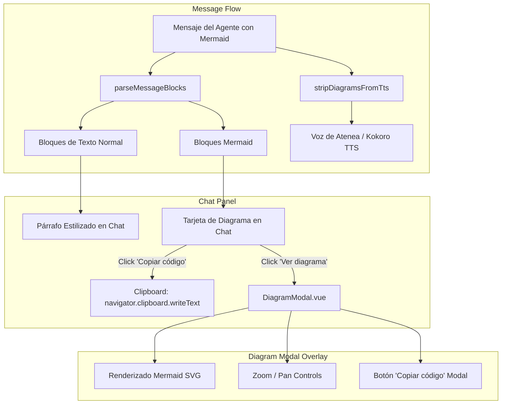

# SDD: Filtro TTS de Diagramas, Visualizador Modal Interactivo y Copia al Portapapeles

## 1. Contexto y Objetivos

Cuando los agentes (principalmente **Aracne**, la diseñadora de arquitectura técnica, o Atenea) generan diagramas arquitectónicos, el contenido se produce en bloques de código con sintaxis **Mermaid.js** (por ejemplo: ````mermaid\nflowchart TD ...\n````).

Actualmente:
1. **Lectura por voz (TTS con Kokoro / Web Audio):** El sistema sintetiza todo el contenido del mensaje a audio mediante `playVoiceResponse()`. Esto hace que Atenea lea verbalmente la sintaxis cruda del diagrama (*"flowchart TD A square brackets B arrow arrow C..."*), lo cual es tedioso y carece de sentido para el usuario.
2. **Visualización en el Chat:** Los mensajes se renderizan en texto plano dentro de un bloque `whitespace-pre-wrap`, por lo que el diagrama se muestra como código sin procesar en lugar de una representación gráfica.
3. **Interacción con el Diagrama:** El usuario no dispone de un botón directo para copiar la especificación de Mermaid al portapapeles ni de una vista ampliada para inspeccionar visualmente la arquitectura.

### Objetivos Clave
1. **Filtro Inteligente de TTS:** Evitar que Atenea o cualquier agente lea en voz alta los bloques de diagramas (````mermaid ... ````). Si el mensaje contiene únicamente el diagrama, vocalizar una frase natural y breve (*"He generado el diagrama arquitectónico en pantalla"*). Si contiene explicaciones antes o después, leer fluidamente dichas explicaciones omitiendo el código del diagrama.
2. **Componente de Diagrama en el Chat:** Detectar automáticamente los bloques Mermaid en los mensajes y renderizarlos como una tarjeta interactiva con:
   - Encabezado temático con badge (ej. `DIAGRAMA DE ARQUITECTURA - MERMAID`).
   - Botón **"Copiar código"** con feedback visual (*"¡Copiado!"*).
   - Botón **"Ver diagrama"** para abrir la visualización gráfica en pantalla completa/modal.
3. **Modal de Visualización Gráfica (`DiagramModal.vue`):**
   - Modal superpuesta (*overlay*) con fondo oscuro translúcido (`backdrop-blur`).
   - Renderizado vectorial interactivo (SVG) del diagrama mediante **Mermaid.js**.
   - Barra de herramientas con:
     - Título descriptivo.
     - Controles de zoom / reset para diagramas complejos.
     - Botón **"Copiar código"** para copiar la sintaxis al portapapeles.
     - Botón de cierre (`✕`), cierre al pulsar `Escape` o al clicar fuera.
   - Manejo de errores: Si la sintaxis de Mermaid es inválida, mostrar un aviso elegante con el código resaltado sin romper la interfaz.

---

## 2. Arquitectura de la Solución



---

## 3. Especificación Técnica por Capas

### A. Filtro y Preparación de Audio TTS (`frontend/src/utils/ttsFilter.ts`)
Creamos una función pura y aislada `cleanTextForTts(rawText: string): string` que:
1. Elimina todos los bloques de diagrama Mermaid con expresión regular:
   ```typescript
   const MERMAID_REGEX = /```(?:mermaid|diagram)\s*[\s\S]*?```/gi
   ```
2. Remueve bloques de código genéricos residuales si los hubiera (ej. ````bash ... ````).
3. Si tras eliminar los diagramas el texto resultante queda vacío o solo con espacios (el agente respondió únicamente con el diagrama):
   - Devuelve una locución sustituta natural: `"He generado el diagrama arquitectónico en pantalla."`
4. Si contiene texto introductorio o conclusiones, limpia los formatos markdown (`*`, `#`, `_`, enlaces) y mantiene la narrativa fluida sin interrupciones sintácticas.

### B. Parser de Bloques de Mensaje (`frontend/src/utils/messageParser.ts`)
Función utilitaria pura `parseMessageContent(content: string): MessageBlock[]`:
```typescript
export interface MessageBlock {
  type: 'text' | 'mermaid'
  content: string
}
```
- Divide el contenido en fragmentos secuenciales:
  - Fragmentos de tipo `'text'` para prosa normal.
  - Fragmentos de tipo `'mermaid'` con el código fuente limpio del diagrama (sin los delimitadores ````mermaid y ````).

### C. Componente Modal de Diagrama (`frontend/src/components/DiagramModal.vue`)
- **Props:**
  - `isOpen: boolean`
  - `code: string`
  - `title?: string`
- **Emits:**
  - `close: () => void`
- **Capacidades:**
  - Renderiza el SVG mediante la API oficial de `mermaid` (`mermaid.render()`).
  - Configuración de tema `dark` y paleta de colores coherente con la aplicación (`#00e5ff`, `#10b981`, `#0a192f`).
  - Controles de zoom (Zoom In, Zoom Out, Reset 100%).
  - Soporte de teclado: Escucha tecla `Escape` para cerrar.
  - Botón de copia al portapapeles con estado reactivo `isCopied` durante 2 segundos.
  - Accesibilidad: Atributos ARIA (`role="dialog"`, `aria-modal="true"`, foco gestionado).

### D. Integración en `ChatPanel.vue`
- Se actualiza el renderizado del mensaje del asistente:
  - Itera sobre `parseMessageContent(msg.content)`.
  - Los bloques de texto se muestran con el formato habitual.
  - Los bloques `mermaid` se renderizan como una tarjeta técnica con vista previa de código y acciones (`[Ver diagrama]`, `[Copiar código]`).
- Integra el estado `activeDiagramModal = ref<{ isOpen: boolean; code: string; title: string }>` y monta `<DiagramModal>`.
- Conecta `cleanTextForTts` en `playVoiceResponse()`.

---

## 4. Dependencias

- **`mermaid` (npm package):** Se agrega como dependencia de producción en `frontend/package.json` (`npm install mermaid`).

---

## 5. Plan de Pruebas (TDD)

### Paso 1: Pruebas Unitarias de Utilidades (RED)
- `frontend/src/utils/__tests__/ttsFilter.spec.ts`:
  - Valida que elimina bloques ````mermaid ... ```` sin leer la sintaxis.
  - Valida que genera la locución por defecto cuando el mensaje solo contiene el diagrama.
  - Valida que preserva el texto antes y después del diagrama.
- `frontend/src/utils/__tests__/messageParser.spec.ts`:
  - Valida la separación correcta de bloques mixtos (texto + mermaid + texto).
  - Valida mensajes con solo texto o solo mermaid.

### Paso 2: Pruebas de Componentes (RED)
- `frontend/src/components/__tests__/DiagramModal.spec.ts`:
  - Valida que no se renderiza si `isOpen === false`.
  - Valida que emite el evento `close` al clicar el botón de cierre o presionar Escape.
  - Valida que copia el código al portapapeles y activa el estado de confirmación.
- `frontend/src/components/__tests__/ChatPanel.spec.ts`:
  - Valida que un mensaje con ````mermaid``` muestra los botones de "Ver diagrama" y "Copiar código".
  - Valida que hacer clic en "Ver diagrama" abre la modal con el código correspondiente.
  - Valida que el texto enviado a `playVoiceResponse` no contiene la sintaxis de Mermaid.

### Paso 3: Implementación y Refactorización (GREEN & REFACTOR)
- Ejecutar suite completa con Vitest y validar TypeScript (`vue-tsc`).
