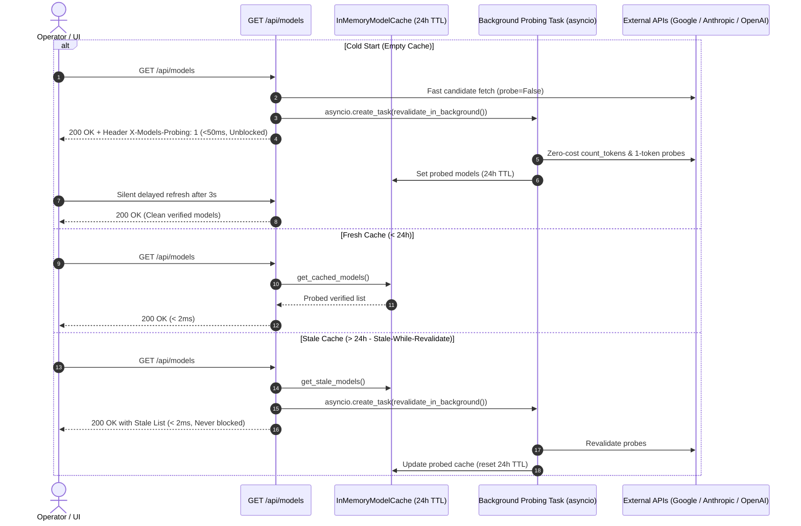

# Feature Specification: Non-Blocking Stale-While-Revalidate (SWR) Model Probing & 24h Caching

## 1. Context & Business Value

In ATENEA, operators configure API credentials for three primary LLM providers: **Google Gemini**, **Anthropic (Claude)**, and **OpenAI**. 
The system exposes available models via `GET /api/models` to populate the provider/model selectors in `AgentCard.vue`.

### Current Problem & Bottleneck
When the user accesses the application, `App.vue` invokes `initializeAppData()` which blocks the screen until `configStore.loadProviders()` (`GET /api/models`) resolves.
Running live probing probes synchronously during this HTTP request blocked the application startup for 2 to 5 seconds while remote providers responded.

### Solution: Stale-While-Revalidate (SWR) Architecture with Optimistic Startup
To ensure 100% non-blocking app entry and dynamic model validation without static whitelists/blacklists:

1. **First Access (Cold Start - Empty Cache):**
   - The endpoint immediately returns a preliminary candidate model list (`probe=False`) in `< 50ms`.
   - The UI entry is never blocked (`App.vue` displays the app immediately).
   - Concurrently, a background async worker (`asyncio.create_task`) executes the full probes (`probe=True`) without blocking HTTP threads.
   - The response includes header `X-Models-Probing: 1`. The frontend `configStore.loadProviders()` detects this and silently refreshes 3 seconds later once the background probe populates the verified cache.
2. **Second Access (Fresh Cache < 24 Hours):**
   - Returns the verified probed models directly from memory in `< 2 ms`.
3. **Third Access (Expired Cache > 24 Hours - Stale-While-Revalidate):**
   - **Zero Wait:** Returns the stale cached models immediately (`< 2 ms`), so the user never notices a delay.
   - Concurrently triggers the background async worker to revalidate and update the cache for subsequent requests.

---

## 2. Architecture & Data Flow



---

## 3. Component Details

### 3.1 `ILLMProvider.list_models(probe: bool = True)`
- Added `probe: bool = True` to `ILLMProvider.list_models`.
- When `probe=False`: returns candidates immediately without performing per-model token counting or generation calls.
- When `probe=True`:
  - **Gemini:** Probes with `client.models.count_tokens("ping")` (free, 0 tokens billed).
  - **Anthropic:** Probes with `client.messages.count_tokens("ping")` (free, 0 tokens billed).
  - **OpenAI:** Probes with 1-token completion dry run.

### 3.2 SWR State Machine in `src/presentation/api/routes/models.py`
- Global memory cache with timestamp and lock:
  ```python
  CACHE_TTL_SECONDS = 86400.0  # 24 hours
  _cached_models: list[dict] = []
  _cache_timestamp: float = 0.0
  _is_probing: bool = False
  _cache_is_verified: bool = False
  ```
- Fast unblocked path on cold start:
  - If `_cached_models` is empty, query all providers with `probe=False`, set `_cached_models` optimistically, trigger `_start_background_probe()`, and return response with `X-Models-Probing: 1`.
  - If expired, return stale `_cached_models`, trigger `_start_background_probe()`, and return response immediately.
- Background worker: runs in background thread via `asyncio.to_thread` or event loop without blocking FastAPI request handlers.

### 3.3 Frontend Reactive Refresh (`frontend/src/stores/config.ts`)
- In `loadProviders()`: checks `response.headers.get('x-models-probing') === '1'`.
- If probing, sets a silent timer `setTimeout(() => this.loadProviders(), 3500)` to update model selectors automatically when probing finishes.

