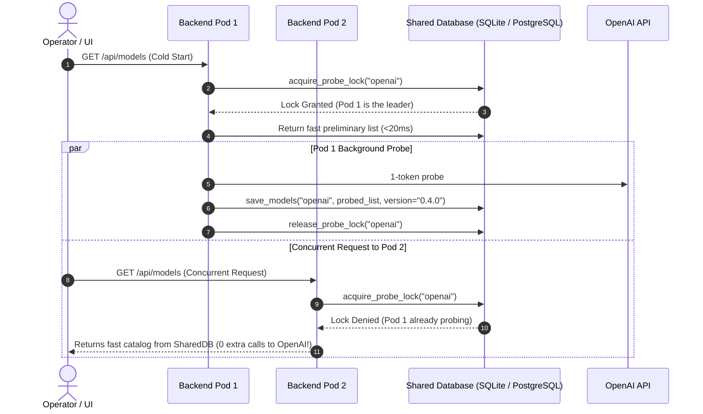

# Feature Specification: Shared Database Model Cache & Distributed Probe Lock

## 1. Context & Business Value

In distributed and enterprise deployments (ADR-021), multiple backend pods run behind a load balancer. 
If model caching is kept in local process RAM:
1. **Cache Fragmentation & Redundant Probes:** Every pod performs its own probe queries against OpenAI and external providers, multiplying billable token consumption and latency across the cluster.
2. **Cluster Inconsistency:** Different pods may hold disparate catalogs depending on when they started.
3. **Deployment Staleness:** Rolling deployments or new releases cannot uniformly invalidate the cache across all running replicas.

### Solution Overview
1. **Hexagonal Domain Port (`IModelCacheRepository`):**
   - Encapsulates shared storage and atomic lock acquisition for model catalogs.
   - Decoupled from transport and specific database engines.
2. **Dual Database Adapter Implementation (SQLite & PostgreSQL):**
   - **Homelab Profile:** `SqliteModelCacheRepository` backed by `atenea.db`.
   - **Enterprise Cloud-Native Profile:** `PostgreSQLModelCacheRepository` backed by connection pool (`asyncpg`).
3. **Atomic Distributed Probe Lock:**
   - When a cache is missing or stale, a pod must atomically acquire a distributed lock (`acquire_probe_lock`) before executing provider probes.
   - Only the winning pod runs the probe (including the OpenAI 1-token probe). All other replicas immediately serve the existing cached or preliminary catalog without firing redundant network calls to OpenAI.
4. **Automated Invalidation on New Deployments:**
   - Catalogs are tagged with `app_version` (or deployment identifier).
   - When a new application version is deployed, pods detect the version mismatch and automatically invalidate or revalidate the cache.
   - Manual invalidation via `GET /api/models?refresh=true` clears the shared table cluster-wide.

---

## 2. Architecture & Data Flow



---

## 3. Data Schema & Contracts

### 3.1 Domain Value Object & Port
```python
@dataclass(frozen=True)
class CachedModelCatalog:
    provider: str
    models: list[dict[str, str]]
    is_verified: bool
    updated_at: float
    app_version: str

class IModelCacheRepository(Protocol):
    def get(self, provider: str) -> Optional[CachedModelCatalog]: ...
    def save(self, catalog: CachedModelCatalog) -> None: ...
    def acquire_probe_lock(self, provider: str, timeout_seconds: float = 60.0) -> bool: ...
    def release_probe_lock(self, provider: str) -> None: ...
    def invalidate_all(self) -> None: ...
```

### 3.2 SQL Schema (`model_cache`)
```sql
CREATE TABLE IF NOT EXISTS model_cache (
    provider TEXT PRIMARY KEY,
    models_json TEXT NOT NULL,
    is_verified INTEGER NOT NULL DEFAULT 0,
    updated_at REAL NOT NULL,
    app_version TEXT NOT NULL,
    is_probing INTEGER NOT NULL DEFAULT 0,
    probe_lock_until REAL NOT NULL DEFAULT 0.0
);
```
