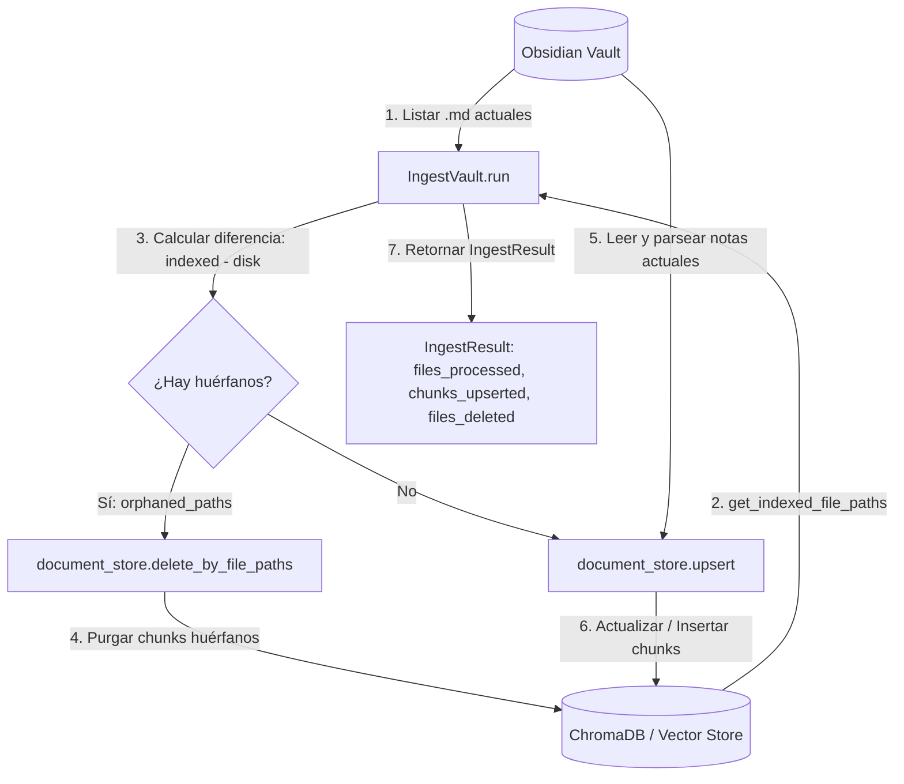

# Documento de Diseño de Software (SDD): Sincronización del Vault y Limpieza de Huérfanos en ChromaDB

## 1. Contexto y Objetivos
El subsistema de memoria a largo plazo y RAG de ATENEA almacena notas técnicas estructuradas en `obsidian_vault/` y vectoriza sus fragmentos (chunks) en **ChromaDB**.

Hasta ahora, la ingesta ejecutada por `IngestVault` era estrictamente aditiva (`upsert`). Si un usuario o proceso eliminaba un archivo `.md` de `obsidian_vault/`, sus chunks correspondientes permanecían almacenados en ChromaDB de forma indefinida como fragmentos huérfanos. Esto provocaba que los agentes (como Metis) siguieran recuperando información obsoleta o eliminada mediante RAG.

### Objetivos Principales:
1. **Sincronización Bidireccional / Reconciliación**:
   - Al ejecutar la ingesta (`IngestVault.run()`), el sistema debe reconciliar el estado en disco con el estado en la base de datos vectorial.
2. **Detección y Purga Automática de Huérfanos**:
   - Identificar los archivos que están registrados en la base vectorial pero que ya no existen en el sistema de archivos del vault, eliminando sus chunks asociados.
3. **Métricas en IngestResult**:
   - Incluir la métrica `files_deleted` en el resultado de la ingesta para trazabilidad y observabilidad.
4. **Desacoplamiento y Portabilidad**:
   - Mantener la arquitectura hexagonal: definir las operaciones en el puerto de dominio `IDocumentStore` e implementarlas en los adaptadores `ChromaDBDocumentStore` e `InMemoryDocumentStore`.

---

## 2. Arquitectura de Sincronización



---

## 3. Especificación de Puertos y Adaptadores

### 3.1. Puerto de Dominio: `IDocumentStore`
Se añaden los siguientes métodos abstractos al contrato `IDocumentStore`:
```python
@abstractmethod
def get_indexed_file_paths(self) -> set[str]:
    """Retorna el conjunto de rutas relativas de archivos actualmente indexados."""

@abstractmethod
def delete_by_file_paths(self, file_paths: list[str]) -> None:
    """Elimina todos los chunks pertenecientes a las rutas de archivo especificadas."""
```

### 3.2. Adaptador: `InMemoryDocumentStore`
- `get_indexed_file_paths()`: Inspecciona los `DocumentChunk.file_path` en `self._store` y retorna el conjunto de rutas únicas.
- `delete_by_file_paths(file_paths)`: Identifica los IDs de chunks cuyo `file_path` coincide con la lista y los elimina del diccionario `_store`.

### 3.3. Adaptador: `ChromaDBDocumentStore`
- Cada chunk en ChromaDB incluye en sus metadatos la clave `_file_path` (ruta relativa en el vault).
- `get_indexed_file_paths()`: Consulta los metadatos de la colección (`self._collection.get(include=["metadatas"])`) y extrae los valores únicos de `_file_path`.
- `delete_by_file_paths(file_paths)`: Ejecuta borrado selectivo en ChromaDB por metadato: `self._collection.delete(where={"_file_path": fp})`.

---

## 4. Servicio de Aplicación: `IngestVault`
En `IngestVault.run(vault_root, document_store, on_file=None) -> IngestResult`:
1. **Descubrimiento local**: Obtiene `current_relative_files = {f.relative_to(vault_root).as_posix() for f in md_files}`.
2. **Detección de huérfanos**:
   - Obtiene `indexed_files = document_store.get_indexed_file_paths()`.
   - Calcula `orphans = indexed_files - current_relative_files`.
3. **Limpieza**:
   - Si `orphans`: invoca `document_store.delete_by_file_paths(list(orphans))`.
   - Registra `result.files_deleted = len(orphans)`.
4. **Upsert**: Parsea los archivos actuales en disco y actualiza sus chunks como hasta ahora.

---

## 5. Estrategia de Pruebas (TDD)
1. **Domain Tests (`test_document_store_port.py`)**:
   - Verificar métodos abstractos en el puerto `IDocumentStore`.
   - Verificar `get_indexed_file_paths` y `delete_by_file_paths` en `InMemoryDocumentStore`.
2. **Infrastructure Tests (`test_chroma_document_store.py`)**:
   - Verificar `get_indexed_file_paths` en colección con chunks.
   - Verificar `delete_by_file_paths` borra exactamente los chunks del archivo indicado sin afectar a otros.
3. **Application Tests (`test_ingest_vault.py`)**:
   - Proceso inicial: ingesta de archivos A y B.
   - Eliminación de archivo B de `tmp_path`.
   - Segunda ingesta: `result.files_deleted == 1`, y la búsqueda de B ya no arroja resultados.
