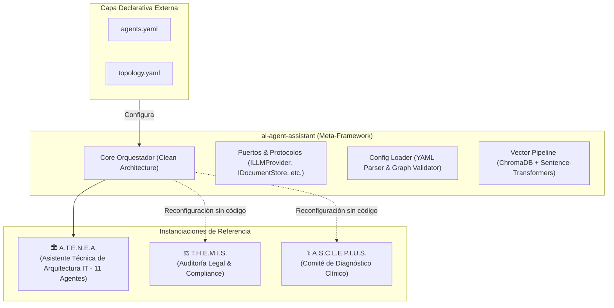

# Capítulo 2: La Dualidad Conceptual: Framework vs Aplicación

Volver a: [[00_meta_project/MOC_Project_TFM|📁 MOC Plataforma & TFM]]

---

## 1. El Principio de Separación Arquitectónica

Uno de los pilares metodológicos más destacados de este TFM es la separación matemática y estricta entre el **motor generador** y la **aplicación concreta instanciada**:

---

## 2. Comparativa Fundamental

| Eje Dimensional | `ai-agent-assistant` (Framework) | `ATENEA` (Aplicación) |
| :--- | :--- | :--- |
| **Naturaleza** | Meta-framework generador de agentes IA | Asistente técnica y evaluadora de arquitecturas IT |
| **Dominio de Negocio** | Completamente agnóstico al dominio | Ingeniería de software, Cloud, DevOps y Ciberseguridad |
| **Definición de Agentes** | No contiene agentes cableados en código | Declarada en `agents.yaml` (11 especialistas) |
| **Topología y Fases** | Motor de grafos de estados reconfigurable | Declarada en `topology.yaml` (4 fases deliberativas) |
| **Garantía de Desacoplamiento** | AST Guard (`test_decoupling_guard.py`) | Cumple el contrato y es auditada por el guardián |
| **Base de Conocimiento** | Adaptador genérico para vaults Markdown | Vault estructurado con estándares corporativos |

---

## 3. Demostración de Extensibilidad Declarativa

Para demostrar al tribunal que el sistema no está acoplado a la arquitectura de software, se diseñó la prueba de instanciación alternativa:

### Caso: "THEMIS" (Auditoría Legal)
Modificando exclusivamente `agents.yaml` y `topology.yaml`:
- **Supervisor:** `Themis` (Presidenta de la corte evaluadora).
- **Propositor 1:** `Lex` (Defensor de la viabilidad regulatoria y negocio).
- **Propositor 2:** `Veritas` (Fiscal de riesgos legales y protección de datos).
- **Juez:** `Solon` (Auditor de jurisprudencia y sanciones).
- **Secretario:** `Clio` (Generador de dictámenes jurídicos en el Vault).

El sistema arranca de forma idéntica, genera la misma deliberación dialéctica en tiempo real, aplica puntos de control humano (HITL) y exporta dictámenes sin tocar una sola línea de backend ni de frontend.

