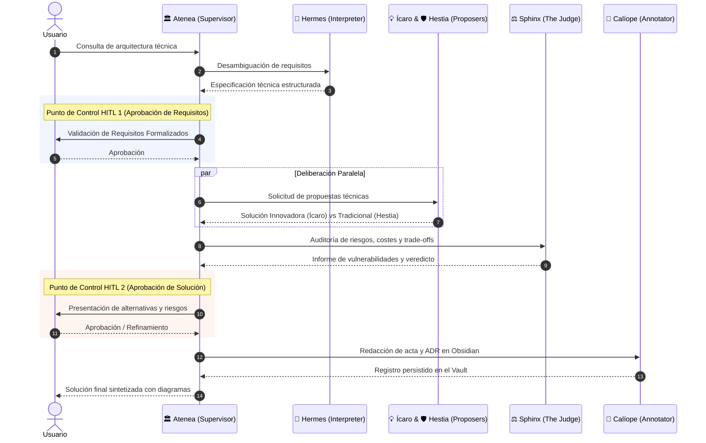

# Capítulo 3: Arquitectura Limpia y Patrón Supervisor Colegiado

Volver a: [[00_meta_project/MOC_Project_TFM|📁 MOC Plataforma & TFM]]

---

## 1. Diseño Arquitectónico: Hexagonal / Clean Architecture

El sistema sigue estrictamente el patrón de **Clean Architecture (Puertos y Adaptadores)** para aislar la lógica nuclear de cualquier librería, base de datos o proveedor de LLM:

```
src/
├── domain/                    <-- Entidades y Puertos (Protocols/Abstract)
│   ├── entities/              (User, Task, ArchitectureSolution)
│   ├── ports/                 (ILLMProvider, IDocumentStore, IDebateRepository)
│   └── value_objects/         (DocumentChunk, SearchFilter, HITLDecision)
├── application/               <-- Casos de Uso y Servicios
│   ├── agents/                (supervisor_agent, sub_agent_runner)
│   ├── services/              (ingest_vault, query_vault, learn_from_source)
│   └── use_cases/             (run_agent_task, auth_service)
├── infrastructure/            <-- Adaptadores Técnicos Concretos
│   ├── llm/                   (gemini_adapter, openai_adapter, anthropic_adapter)
│   ├── rag/                   (chroma_document_store, obsidian_parser)
│   ├── persistence/           (sqlite_debate_repository, sqlite_user_repository)
│   └── audio/                 (local_audio_service con faster-whisper y kokoro)
└── presentation/              <-- Interfaces Externas
    ├── api/                   (FastAPI routes, WebSockets bidireccionales)
    └── cli/                   (Typer CLI para comandos y sincronización)
```

---

## 2. El Patrón Supervisor Colegiado (Collegiate Supervisor)

A diferencia de los patrones supervisores clásicos donde el orquestador simplemente delega subtareas en cascada, en este sistema la supervisión es **dialéctica y deliberativa**:



### 2.1 Salvaguarda contra el Colapso del Debate (Dialectical Integrity)

En sistemas multi-agente deliberativos iterativos (donde los propositores refinan sus propuestas ante las críticas de los auditores antes del checkpoint humano), existe el riesgo crítico del **Colapso del Debate (Debate Collapse)**: que el agente innovador (Ícaro), ante la primera objeción de falta de estándar de la empresa emitida por Sphinx, capitule y modifique su stack a uno conservador. Esto homogeneizaría las propuestas, privando al comité humano (HITL) de juzgar la disrupción.

Para evitarlo, la arquitectura incorpora la regla de **Integridad Dialéctica**:
1. **Firmeza Innovadora de Ícaro:** Las críticas de Sphinx obligan a Ícaro a **mitigar y justificar** (aislamiento por contenedores, compilación nativa, APIs gRPC desacopladas o propuesta de redacción de un ADR excepcional), pero le prohíben abandonar su tesis nuclear antes del arbitraje humano.
2. **Defensa del Pragmatismo de Hestia:** Hestia robustece su solución demostrando cómo la simplicidad del stack corporativo elimina los riesgos operacionales señalados.
3. **Soberanía Humana Real en HITL 2:** El usuario evalúa alternativas genuinamente diferenciadas, manteniendo la tensión dialéctica intacta.

---

## 3. Principio Local-First y Gobernanza de Datos
1. **Embeddings Locales:** `all-MiniLM-L6-v2` se ejecuta localmente mediante `sentence-transformers`, sin enviar datos privados fuera de la infraestructura corporativa.
2. **Motor Vectorial Local:** ChromaDB embebido en disco con persistencia en SQLite local.
3. **Modelos de Audio Locales:** Whisper (STT) y Kokoro/Piper (TTS) se ejecutan completamente offline.
4. **Dualidad de Proveedores LLM:** Soporte para Gemini Enterprise (Vertex AI) con garantía de no retención de datos ni entrenamiento sobre prompts empresariales.

