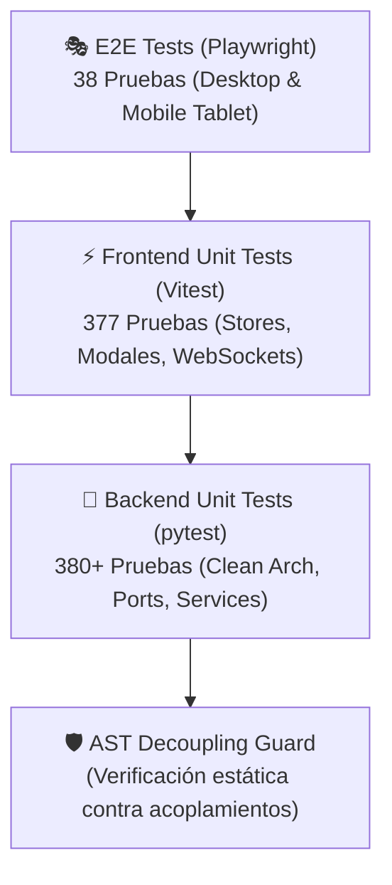

# Capítulo 4: Harness de Pruebas y Fiabilidad del Sistema

Volver a: [[00_meta_project/MOC_Project_TFM|📁 MOC Plataforma & TFM]]

---

## 1. El Concepto de Harness de Pruebas

En el ámbito de la ingeniería de software y los sistemas agenticos, un **Test Harness (arnés de pruebas)** es el conjunto coordinado de herramientas, mocks deterministas, fixtures y suites automatizadas diseñadas para someter a una aplicación a validaciones exhaustivas bajo condiciones controladas y reproducibles.

Debido a la naturaleza no determinista de los Modelos de Lenguaje (LLMs), el arnés de este proyecto implementa una estrategia de **doble barrera**:
1. **Verificación Estática y Aislamiento:** Análisis de AST de código fuente y aislamiento total de APIs externas mediante mocks deterministas.
2. **Verificación Dinámica y Reactiva:** Pruebas E2E de navegador que simulan eventos de usuario, WebSockets y renderizado de componentes.

---

## 2. Pirámide de Testing Implementada

---

## 3. Métricas y Suites de Validación

### 3.1 Backend (Pytest)
- **Cobertura de Capas:** Domain, Application, Infrastructure y Presentation.
- **Tolerancia a Fallos:** Pruebas de degradación elegante ante caídas de WebSocket, timeouts de LLM y concurrencia.
- **AST Guard Rails:** `test_decoupling_guard.py` inspecciona el árbol sintáctico del código para asegurar que ningún nombre de agente (`Hermes`, `Ícaro`, `Hestia`, etc.) esté hardcodeado en la lógica del motor.

### 3.2 Frontend (Vitest)
- **377 pruebas unitarias ejecutadas en < 14 segundos**.
- Validación de stores Pinia (`debate.ts`, `auth.ts`), parsers de markdown, exportadores de diapositivas (`slideParser.ts`) y modales interactivos (`DiagramModal`, `PresentationModal`, `DocumentModal`).

### 3.3 End-to-End (Playwright)
- **38 pruebas de extremo a extremo** ejecutadas sobre navegadores reales (Chromium, WebKit, Mobile Safari, Desktop Chrome).
- Validación de flujos HITL reales: el usuario recibe la propuesta, pulsa "Refinar", envía feedback y el agente reanuda la deliberación.

