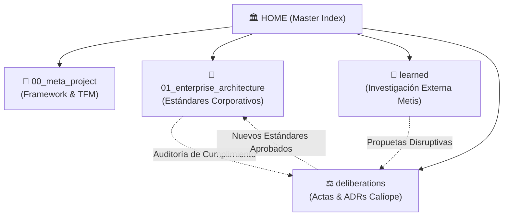

# 🏛️ ATENEA Knowledge Hub — Master Index

Bienvenido al centro de conocimiento unificado gobernado por **ATENEA** (*Asistente Técnica y Evaluadora de Nuevas Estructuras y Arquitecturas*).

Este grafo de conocimiento se encuentra articulado en **4 macro-dominios jerárquicos** interconectados mediante **Mapas de Contenido (MOCs)** para garantizar la trazabilidad arquitectónica, evitar la contaminación de contexto en el motor RAG y sostener el aprendizaje continuo bajo gobernanza humana (**HITL**).

---

## 🗺️ Dominios de Conocimiento

### 1. [[00_meta_project/MOC_Project_TFM|📁 00_meta_project — Plataforma & TFM]]
> **Propósito:** Especificaciones técnicas, diseño arquitectónico del motor multi-agente, harness de pruebas y memoria académica para la defensa del TFM.
> - **Acceso rápido:** [[00_meta_project/tfm/01_abstract_and_motivation|01. Resumen y Motivación]] · [[00_meta_project/tfm/02_agentic_framework_vs_app|02. Framework vs ATENEA]] · [[00_meta_project/tfm/03_system_architecture|03. Arquitectura Limpia]] · [[00_meta_project/tfm/04_testing_and_harness|04. Harness de Pruebas]] · [[00_meta_project/tfm/05_conclusions_and_future|05. Conclusiones]]
> - **Especificaciones de la plataforma:** [[docs/features/feature_4_agent_config|Configuración Declarativa]] · [[docs/features/feature_dynamic_knowledge_domains|Dominios Dinámicos]]

### 2. [[01_enterprise_architecture/MOC_Enterprise_Architecture|🏢 01_enterprise_architecture — Arquitectura Empresarial]]
> **Propósito:** Base de conocimiento de la organización. Contiene el catálogo oficial de tecnologías aprobadas, directrices de ciberseguridad, patrones de microservicios y ADRs corporativos.
> - **Consumidores principales:** **Hestia** (Senior Architect) y **Sphinx** (The Judge).
> - **Acceso rápido:** [[01_enterprise_architecture/tech_stack/approved_stack|Stack Tecnológico Aprobado]] · [[01_enterprise_architecture/guidelines/security_and_identity|Seguridad & Identidad]] · [[01_enterprise_architecture/patterns/microservices_blueprint|Blueprint de Microservicios]]

### 3. [[learned/MOC_Learned_Knowledge|🔬 learned — Investigación & Aprendizaje Externo]]
> **Propósito:** Artículos, whitepapers técnicos y documentación oficial de nubes públicas asimilados de forma autónoma por **Metis** mediante URLs y PDFs.
> - **Consumidores principales:** **Ícaro** (Innovator Architect).
> - **Destacados:** Google Cloud Pub/Sub, Cloud Tasks, Arquitecturas Asíncronas y Asistentes de Voz.

### 4. [[deliberations/MOC_Deliberations|⚖️ deliberations — Actas de Sesiones & Acuerdos]]
> **Propósito:** Memoria histórica de los debates celebrados en el consejo colegiado, formalizados en actas estructuradas por **Calíope** tras la síntesis de **Atenea**.

---

## ⚙️ Reglas de Operación del Grafo
- **Aislamiento Semántico:** Cada documento declara en su cabecera `category: meta-project | enterprise | external-learning | deliberation` para filtrado selectivo en ChromaDB.
- **Gobernanza Activa (HITL):** Nuevos documentos ingresados sin contexto son clasificados previa confirmación humana por **Metis**.

