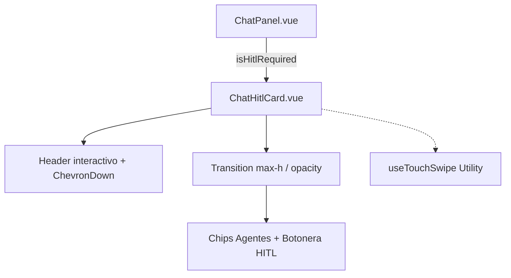

# Software Design Document (SDD) - Tarjeta HITL Colapsable / Ocultable en Chat

## 1. Introducción y Problema

### 1.1 Contexto Actual
En el flujo de debate colegiado multi-agente, cuando un agente o el supervisor requiere intervención humana (**HITL - Human In The Loop**), se activa el estado `store.isHitlRequired = true`. En ese momento, [ChatPanel.vue](file:///Users/jesusjimenezvaquero/Documents/WS/ai-agent-assistant/frontend/src/components/ChatPanel.vue) monta el componente [ChatHitlCard.vue](file:///Users/jesusjimenezvaquero/Documents/WS/ai-agent-assistant/frontend/src/components/chat/ChatHitlCard.vue) en la sección inferior fija del chat, justo encima del [ChatComposer.vue](file:///Users/jesusjimenezvaquero/Documents/WS/ai-agent-assistant/frontend/src/components/chat/ChatComposer.vue).

### 1.2 Problema Detectado
- En pantallas móviles y dispositivos con viewport vertical reducido (menos de 700px de altura), la tarjeta HITL completa ocupa entre **180px y 240px** de altura debido a:
  1. Cabecera con título y botón de reintento.
  2. Selector de chips de agentes destino (`selectableAgents`).
  3. Rejilla de 6 botones de acción rápida en 2 filas (`Aceptar`, `Consolidar`, `Finalizar`, `Refinar`, `Desviar`, `Rechazar`).
- Esto, sumado al `ChatComposer` y la cabecera de la aplicación, deja la ventana de mensajes (`ChatMessageList`) con menos de 150px útiles, impidiendo al usuario leer con claridad el dictamen de los agentes, inspeccionar diagramas de arquitectura recién generados o hacer scroll cómodo por el historial antes de tomar una decisión.

### 1.3 Objetivo
Permitir que la tarjeta de control HITL sea **ocultable/colapsable y desplegable** de forma análoga a la barra de sonido ([SoundBar.vue](file:///Users/jesusjimenezvaquero/Documents/WS/ai-agent-assistant/frontend/src/components/SoundBar.vue)):
1. **Cabecera compacta interactiva:** Siempre visible mientras HITL esté activo, con indicador luminoso ámbar pulsante, texto descriptivo y botón/flecha de chevron (`ChevronDown`).
2. **Cuerpo colapsable:** Oculta los chips y la botonera de acciones para liberar el 100% del espacio del chat y permitir scroll libre.
3. **Gestos táctiles (Mobile UX):** Soporte para deslizar hacia arriba (`swipe up`) para desplegar y hacia abajo (`swipe down`) para colapsar mediante `useTouchSwipe`.
4. **Comportamiento reactivo adaptativo (Mobile-First):**
   - En **móvil** (`window.innerWidth < 768`), la tarjeta aparece **colapsada de inicio** por defecto (`isCollapsed = true`), permitiendo al usuario ver el chat y hacer scroll sin bloqueos visuales desde el primer instante. Muestra una barra compacta de ~36px con el indicador ámbar pulsante y chevron para desplegar.
   - En **escritorio** (`window.innerWidth >= 768`), la tarjeta aparece **desplegada de inicio** (`isCollapsed = false`) aprovechando el mayor espacio vertical.
   - En ambos entornos, el usuario puede alternar el estado en cualquier momento con un clic en el chevron o mediante gestos de swipe.

---

## 2. Diseño de Experiencia de Usuario (UX / UI)

### 2.1 Estados Visuales

#### A. Estado Desplegado (Expanded - Default al activarse HITL)
- **Cabecera:**
  - Izquierda: Punto ámbar pulsante + Texto `"PUNTO DE CONTROL (HITL)"`.
  - Centro/Derecha: Botón de alternancia con icono `ChevronDown` (rotación `0deg`) y botón de reintento (`RotateCcw`).
- **Cuerpo (animado con CSS Transition):**
  - Selector de chips de agentes disponibles.
  - Grilla de botones de acción rápida (`Aceptar`, `Consolidar`, `Finalizar`, `Refinar`, `Desviar`, `Rechazar`).

#### B. Estado Colapsado (Collapsed)
- **Cabecera Compacta (altura ~36px):**
  - Izquierda: Punto ámbar pulsante + `"PUNTO DE CONTROL (HITL)"` + badge o texto sutil `"PULSA PARA DESPLEGAR"`.
  - Centro/Derecha: Botón de alternancia con `ChevronDown` (rotación `180deg` en color ámbar) + botón de reintento accesible.
- **Cuerpo:**
  - Oculto con `opacity-0` y `max-h-0` mediante `Transition`.
  - Altura del contenedor inferior en `ChatPanel.vue` reducida automáticamente, liberando espacio para el listado de mensajes.

### 2.2 Gestos y Accesibilidad
- Soporte táctil en móviles mediante la utilidad existente [touchSwipe.ts](file:///Users/jesusjimenezvaquero/Documents/WS/ai-agent-assistant/frontend/src/utils/touchSwipe.ts):
  - Deslizar hacia arriba (`onSwipeUp`): Expande la botonera.
  - Deslizar hacia abajo (`onSwipeDown`): Colapsa la botonera.
- Accesibilidad ARIA:
  - `aria-expanded="true|false"` en el botón de toggle.
  - `aria-controls="hitl-card-body"` referenciando el panel de botones.
  - Atributos `title` y `aria-label` descriptivos.

---

## 3. Arquitectura y Componentes Afectados

### 3.1 [ChatHitlCard.vue](file:///Users/jesusjimenezvaquero/Documents/WS/ai-agent-assistant/frontend/src/components/chat/ChatHitlCard.vue)
- **Nuevas Props:**
  - `initialCollapsed?: boolean` (opcional: si no se especifica, calcula `typeof window !== 'undefined' ? window.innerWidth < 768 : false` para colapsar automáticamente solo en móvil).
  - `collapsible?: boolean` (por defecto `true`).
- **Estado Reactivo Interno:**
  - `const isMobile = typeof window !== 'undefined' ? window.innerWidth < 768 : false`
  - `const isCollapsed = ref(props.initialCollapsed ?? isMobile)`
  - Función `toggleCollapse()`, `expand()`, `collapse()`.
  - Vinculación con `useTouchSwipe(hitlCardRef, { onSwipeUp: expand, onSwipeDown: collapse })`.
- **Plantilla (`<template>`):**
  - La cabecera se transforma en un contenedor interactivo con botón `data-test="hitl-collapse-toggle"`.
  - El cuerpo de chips y botones se envuelve en `<Transition>` con clases Tailwind coherentes con `SoundBar.vue`.

### 3.2 [ChatPanel.vue](file:///Users/jesusjimenezvaquero/Documents/WS/ai-agent-assistant/frontend/src/components/ChatPanel.vue)
- Ajuste del contenedor contenedor inferior (`div.p-4.border-t`):
  - Sustituir la altura mínima rígida `md:min-h-[162px]` por un layout flexible `shrink-0 transition-all duration-300`, permitiendo que al colapsarse en móvil el panel inferior no deje espacio en blanco artificial.

---

## 4. Plan de Pruebas (TDD)

### 4.1 Fase RED: Pruebas Unitarias de Componente
En `frontend/src/components/chat/__tests__/ChatSubcomponents.spec.ts` y `frontend/src/components/__tests__/ChatPanel.spec.ts`:
1. **Prueba 1 (Render inicial desplegado):** Verificar que `ChatHitlCard` se monta con el botón de colapso y el cuerpo visible.
2. **Prueba 2 (Alternancia al clicar toggle):** Simular clic en `data-test="hitl-collapse-toggle"` y comprobar que el estado pasa a colapsado y la rotación del icono cambia.
3. **Prueba 3 (Soporte de gestos táctiles):** Simular eventos táctiles `touchstart` / `touchend` hacia arriba y hacia abajo para validar expansión y colapso.
4. **Prueba 4 (Mantenimiento de acciones):** Verificar que los eventos (`approve`, `refine`, etc.) siguen funcionando correctamente al interactuar con los botones.

### 4.2 Fase GREEN: Implementación
1. Implementar la reactividad y template en `ChatHitlCard.vue`.
2. Adaptar el estilo del contenedor en `ChatPanel.vue`.
3. Ejecutar `npm run test:unit` y verificar que todos los tests pasan.

### 4.3 Fase REFACTOR: Limpieza y Accesibilidad
1. Validar tipos con `vue-tsc --build`.
2. Validar reglas de estilo con `oxlint` y `eslint`.

