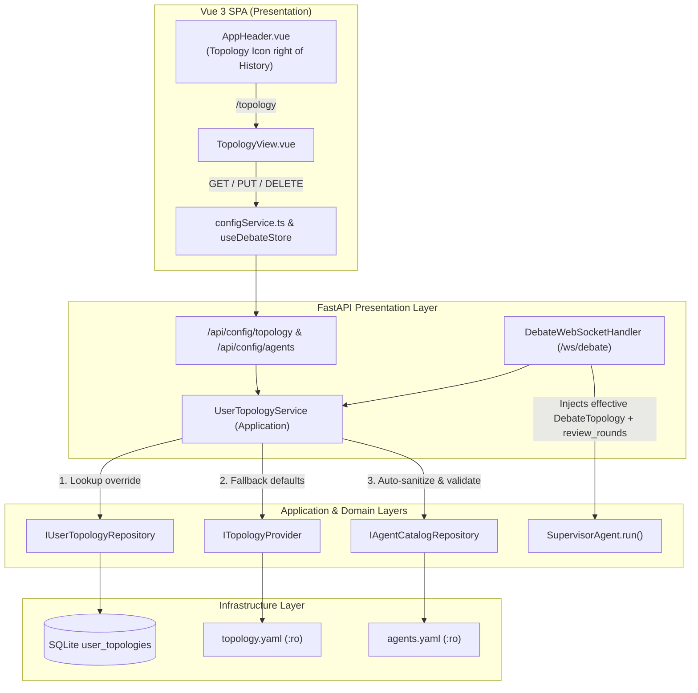

# Feature Specification: Per-User Dynamic Debate Topology & Declarative Review Rounds

## 1. Context & Problem Statement

In ATENEA's declarative multi-agent architecture, two core YAML files define the reference system at startup:
- `agents.yaml`: Catalog of specialist profiles (`SubAgentProfile`).
- `topology.yaml`: Directed Acyclic Graph (DAG) slot mapping (`supervisor`, `interpreters`, `proposers`, `reviewers`, `evaluators`, `implementers`).

While **ADR-022** and **ADR-023** introduced per-user configuration overrides for each agent's LLM provider, model name, and RAG parameters (`rag_top_k`, `rag_min_score`), the debate topology (`topology.yaml`) and peer-review loop count (`REVIEW_ROUNDS`) remained static and global across all operators sharing an ATENEA instance. Because `topology.yaml` is mounted read-only (`:ro`) in containerized deployments, operators could not customize which specialists participate in each debate phase or adjust `review_rounds` on the fly without affecting other users or restarting containers.

### Key Objectives

1. **Declarative `review_rounds` in `topology.yaml`:** Promote `review_rounds` into `topology.yaml` and `DebateTopology` as an intrinsic property of the debate graph, while preserving `REVIEW_ROUNDS` in `.env` as an optional environment override.
2. **Immutable Supervisor Invariant:** The `supervisor` slot defined in `topology.yaml` is strictly read-only and cannot be modified or customized by any user.
3. **Per-User Topology Persistence & Isolation:** Allow each authenticated operator to customize the `0..N` specialist sets for `interpreters`, `proposers`, `reviewers`, `evaluators`, and `implementers` (without intra-slot ordering, as specialists within a phase execute concurrently) alongside their preferred `review_rounds` (`0..5`).
4. **Priority Chain & Transparent Initial Load:**
   - Effective resolution order: **1st User Preference (DB) -> 2nd Explicit `REVIEW_ROUNDS` env / `topology.yaml` canonical defaults**.
   - First-time users with no saved customization seamlessly receive and visualize the exact canonical `topology.yaml` and default `review_rounds` (`is_customized: false`).
5. **Silent Auto-Sanitization:** If an agent previously saved in a user's custom topology is later removed from `agents.yaml` (or marked `is_supervisor` / `can_ingest_documents`), the resolution service automatically strips that obsolete agent from the user's role slots without failing.
6. **Reset to Defaults:** Provide a one-click reset action (`DELETE /api/config/topology`) that deletes the user's persisted override so `topology.yaml` defaults take effect immediately.
7. **Dedicated Frontend View (`/topology`):** Add a header navigation icon in `AppHeader.vue` immediately to the right of the History button (`history-btn`), routing to a dedicated `TopologyView.vue` screen that renders only assigned specialists per phase using `AgentCard.vue` (`variant="topology"`) with full mission descriptions and opens a native `<dialog>` specialist picker modal (`+ Añadir especialista`) on demand.

---

## 2. Architecture & Data Flow



---

## 3. Domain, Persistence & API Contracts

### 3.1 Domain Value Objects & Ports

- **`DebateTopology` (`src/domain/agents/debate_topology.py`):**
  - Adds `review_rounds: int | None = None`.
  - `validate()` verifies `0 <= review_rounds <= 5` when `review_rounds is not None`.
- **`UserTopologyConfig` (`src/domain/value_objects/user_topology_config.py`):**
  - Immutable `@dataclass(frozen=True)` holding `user_id`, `interpreters`, `proposers`, `reviewers`, `evaluators`, `implementers`, and `review_rounds: int = 1`.
  - Intentionally omits `supervisor` so supervisor overrides cannot be represented in user storage.
- **`IUserTopologyRepository` (`src/domain/ports/user_topology_repository.py`):**
  - `find_by_user_id(user_id: str) -> UserTopologyConfig | None`
  - `save(config: UserTopologyConfig) -> None`
  - `delete_by_user_id(user_id: str) -> None` (also invoked during `AuthService` `hard` user deletion).

### 3.2 SQLite Schema (`user_topologies`)

```sql
CREATE TABLE IF NOT EXISTS user_topologies (
    user_id       TEXT PRIMARY KEY,
    interpreters  TEXT NOT NULL DEFAULT '[]',
    proposers     TEXT NOT NULL DEFAULT '[]',
    reviewers     TEXT NOT NULL DEFAULT '[]',
    evaluators    TEXT NOT NULL DEFAULT '[]',
    implementers  TEXT NOT NULL DEFAULT '[]',
    review_rounds INTEGER NOT NULL DEFAULT 1,
    updated_at    TEXT NOT NULL DEFAULT CURRENT_TIMESTAMP
);
```

### 3.3 REST API Endpoints (`/api/config/topology`)

- **`GET /api/config/topology`** (Optional auth):
  - Unauthenticated requests (e.g. Login / Setup screens) receive canonical `topology.yaml` values with `is_customized: false`.
  - Authenticated requests receive the user's effective topology, `review_rounds`, `is_customized: bool`, read-only `supervisor_agent` metadata, and `eligible_agents` list.
- **`PUT /api/config/topology`** (Authenticated):
  - Validates `0 <= review_rounds <= 5`, rejects any attempt to alter `supervisor`, rejects unknown/supervisor/document-ingestion agents, deduplicates agents per slot, requires at least one active specialist across execution phases, persists the user's override, and returns the resolved payload (`is_customized: true`).
- **`DELETE /api/config/topology`** (Authenticated):
  - Deletes the user's row in `user_topologies` and returns the restored canonical topology (`is_customized: false`).

---

## 4. Acceptance Criteria

1. `topology.yaml` declares `review_rounds: 1` and `YamlTopologyProvider` loads it into `DebateTopology`.
2. Unauthenticated `GET /api/config/topology` continues returning `200 OK` with default project metadata and `is_customized: false`.
3. User A saving a custom topology (e.g., adding `Hefesto` to `proposers` and setting `review_rounds: 3`) does not alter User B's `GET /api/config/topology`, `GET /api/config/agents` `topology_roles`, or `/ws/debate` execution.
4. Attempting to modify `supervisor` via `PUT /api/config/topology` returns `422 Unprocessable Entity`.
5. Removing an agent from `IAgentCatalogRepository` after a user configured it causes `UserTopologyService` to silently strip that agent from the user's resolved topology without raising an error.
6. Clicking **"Restablecer valores por defecto"** in `TopologyView.vue` calls `DELETE /api/config/topology`, clearing the DB record and restoring `topology.yaml` + default `review_rounds`.
7. `AppHeader.vue` renders the Topology navigation button immediately to the right of `history-btn`, navigating to `/topology`.
8. `test_decoupling_guard.py` passes all static AST and council-agnostic checks with zero violations.

