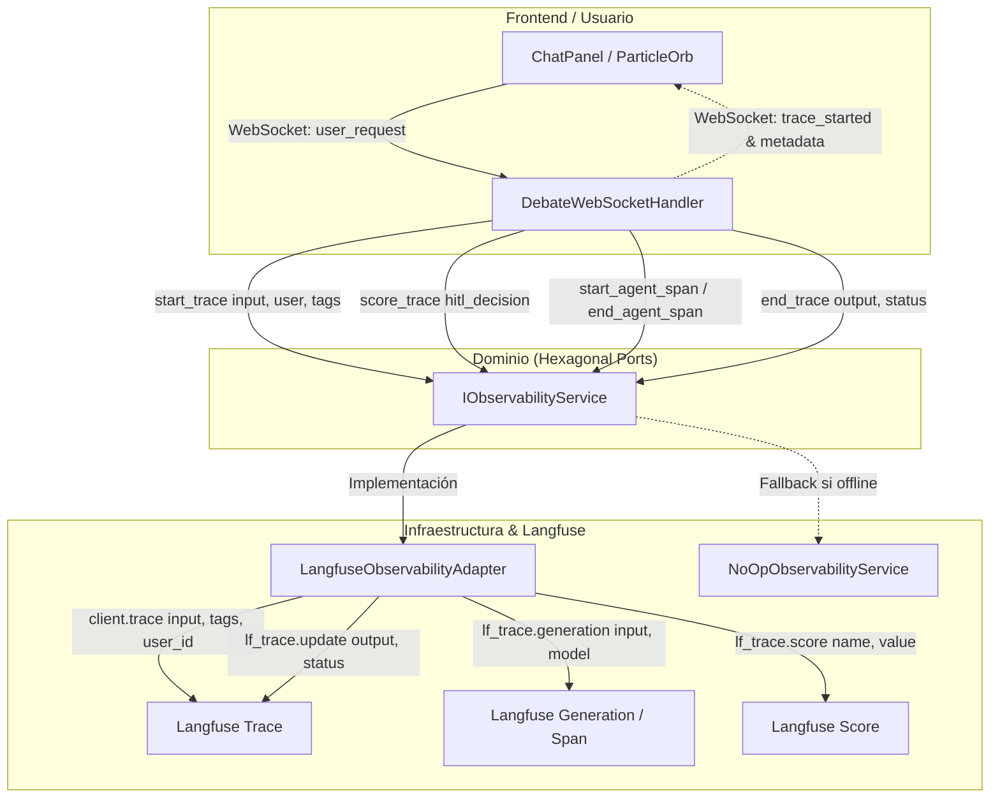

# SDD: Refinamiento Integral de Métricas y Trazabilidad en Langfuse

## 1. Contexto y Objetivos

Atenea utiliza **Langfuse** como plataforma de observabilidad para la orquestación multi-agente (Atenea Supervisor, Fídias, Metis, Calíope, Hermes, Hestia, Dédalo, etc.). 
Aunque el adaptador base `LangfuseObservabilityAdapter` y el stack Docker estaban desplegados, se detectaron carencias operativas en las trazas generadas:

### Deficiencias Detectadas
1. **Inputs no registrados en el dashboard:** Los mensajes de entrada de usuario no se enviaban en el parámetro nativo `input` de `client.trace()`, sino encapsulados en un diccionario de `metadata`. En la UI de Langfuse, la columna y panel de **Input** aparecían vacíos.
2. **Ausencia de Tags:** No se emitían tags descriptivos (`tags=[]`), impidiendo filtrar en el dashboard por agente (`agent:fidias`, `agent:caliope`), tipo de flujo (`flow:debate`, `flow:direct`), presencia de RAG (`has:rag`) o evaluación humana (`has:hitl`).
3. **Ausencia de Scores (Evaluaciones):** No existía capacidad de registrar métricas de calidad o decisiones de usuario. En particular, las resoluciones de **Human-in-the-Loop (HITL)** (aprobar, refinar, cancelar) no quedaban registradas como métricas numéricas.
4. **Falta de User ID y exposición de Trace ID:** Langfuse mostraba `User: N/A` porque el puerto no recibía `user_id`. Además, el `trace_id` generado no se propagaba al frontend, impidiendo la correlación bidireccional entre la interfaz y la telemetría.
5. **Generaciones con Prompts incompletos:** En los spans de subagentes no se capturaba el prompt final estructurado (system prompt + directivas visuales + contexto).

### Objetivos Clave
1. **Ampliación del Puerto `IObservabilityService`:** Extender las firmas de `start_trace` con `input_data`, `user_id`, `tags` y añadir `score_trace()`.
2. **Implementación en `LangfuseObservabilityAdapter`:** Conectar nativamente `input`, `user_id`, `tags` en `client.trace()`, registrar `output` en `end_trace()` y agregar `lf_trace.score()` / `client.score()`.
3. **Garantía de Degradación Elegante (Graceful Degradation):** Actualizar `NoOpObservabilityService` para mantener compatibilidad total cuando Langfuse esté apagado o inaccesible.
4. **Integración en el Ciclo de Vida del Debate (`debate.py`):**
   - Registrar `input_data` nativo con el texto del usuario.
   - Generar tags contextuales automáticos (`agent:*`, `flow:*`, `has:hitl`, `has:rag`).
   - Asociar `user_id` identificable.
   - Registrar automáticamente un Score en Langfuse ante decisiones HITL (`1.0` aprobación, `0.5` refinamiento, `0.0` rechazo).
   - Emitir el `trace_id` hacia el frontend vía WebSocket.

---

## 2. Arquitectura de la Solución



---

## 3. Modelo de Datos y Contratos de Métricas

### 3.1 TraceContext Ampliado
```python
@dataclass(frozen=True)
class TraceContext:
    trace_id: str
    session_id: str
    name: str
    user_id: str | None = None
    tags: list[str] = field(default_factory=list)
    metadata: dict[str, Any] = field(default_factory=dict)
```

### 3.2 Taxonomía de Tags en Atenea
| Tag | Categoría | Significado / Activación |
| :--- | :--- | :--- |
| `agent:<role>` | Agente | Agente objetivo invocado (`agent:fidias`, `agent:caliope`, `agent:metis`, `agent:supervisor`). |
| `flow:supervisor_debate` | Flujo | Debate multidireccional orquestado por Atenea. |
| `flow:sub_agent` | Flujo | Ejecución directa de un especialista técnico. |
| `has:hitl` | Capacidad | El agente o flujo soporta puntos de control Human-in-the-Loop. |
| `has:rag` | Capacidad | El agente consultó o ingestó conocimiento del Obsidian Vault / ChromaDB. |
| `has:attachments` | Entrada | La petición incluyó documentos o archivos adjuntos. |
| `env:<environment>` | Entorno | `env:local`, `env:docker` o `env:production`. |

### 3.3 Taxonomía de Scores en Langfuse
| Score Name | Tipo | Valores | Evento Desencadenante |
| :--- | :--- | :--- | :--- |
| `hitl_decision` | Numérico [0.0 - 1.0] | `1.0` (Aprobado), `0.5` (Refinado), `0.0` (Rechazado) | Interacción en modal HITL por el usuario. |
| `tool_execution` | Booleano [0 o 1] | `1` (Éxito), `0` (Fallo) | Generación exitosa de imagen o diagrama. |
| `user_feedback` | Numérico [0.0 o 1.0] | `1.0` (Positivo), `0.0` (Negativo) | Feedback explícito en la UI. |

---

## 4. Estrategia de Fallback y Resiliencia
- Si el SDK de Langfuse falla, lanza timeout o no tiene credenciales, todas las operaciones (`start_trace`, `end_trace`, `start_agent_span`, `end_agent_span`, `score_trace`) capturan excepciones, registran warning en logs y continúan sin interrumpir el debate ni el WebSocket.
- `NoOpObservabilityService` satisface el 100% de los métodos de la interfaz sin coste computacional.

