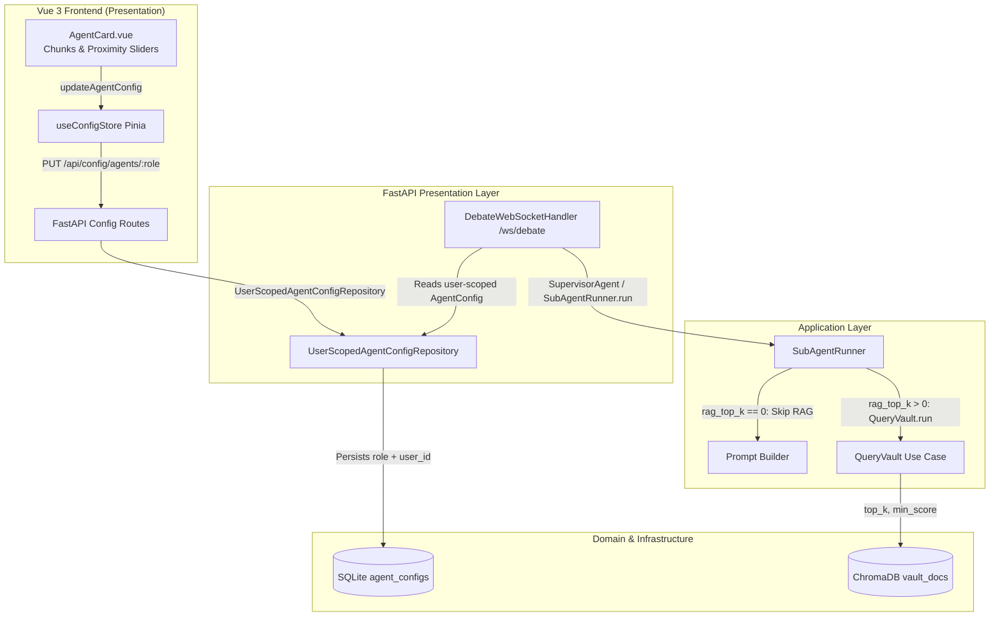

# Feature Specification: Per-Agent & Per-User Dynamic RAG Retrieval Configuration

## 1. Context & Problem Statement

In ATENEA's multi-agent architecture, several specialists (`uses_rag: true`, including `senior_architect` / Ícaro, `innovator` / Hestia, `the_judge` / Esfinge, `devsecops` / Hefesto, `diagrammer` / Aracne, `learning` / Metis, and `caliope` / Calíope) query the local ChromaDB vector store (`vault_docs`) before generating their responses.

Previously, `SubAgentRunner` relied exclusively on static global defaults (`settings.rag_top_k = 5` and `settings.rag_min_score = 0.30`). This static configuration created operational friction in two common scenarios:
1. **Session-Only Consolidation (Noise Suppression):** When an agent such as Calíope (`caliope`) is instructed to document a solution that was just debated in the active chat session (`chat_history`), retrieving chunks from ChromaDB can inject unrelated legacy notes from the Obsidian Vault. The operator needs a fast way to set `Chunks = 0 (OFF)` for that agent without altering global environment variables.
2. **Deep Project Synthesis (Broad Retrieval):** Conversely, when an operator asks Calíope, Metis, or Ícaro to synthesize or audit a broad project already vectorized across many Markdown sections in ChromaDB, `top_k = 5` is too narrow, and the operator needs to increase retrieval up to `20` chunks and adjust the semantic proximity threshold (`0.00` to `1.00`) on the fly.

### Key Objectives
1. **Domain Extension:** Extend the `AgentConfig` value object with optional `rag_top_k: int | None` and `rag_min_score: float | None` fields.
2. **Per-User Persistence & Auto-Migration:** Persist `rag_top_k` and `rag_min_score` per `(role, user_id)` in `SqliteAgentConfigRepository` and `UserScopedAgentConfigRepository`, automatically migrating existing SQLite databases via non-destructive `ALTER TABLE` statements.
3. **Dynamic Runtime Execution (`SubAgentRunner` & `SupervisorAgent`):** Forward user-configured `rag_top_k` and `rag_min_score` to `SubAgentRunner.run()`. When `rag_top_k == 0`, dynamically bypass `QueryVault.run` for that turn even if the agent profile has `uses_rag: true`.
4. **Compact UI Controls in `AgentCard.vue`:** Render two ultra-thin range sliders (`Chunks: 0..20` and `Proximidad: 0.00..1.00`) inside `AgentCard.vue` exclusively for agents with `uses_rag: true`, positioned between the 3-line clamped description and the Provider/Model selectors while preserving the fixed `230px` card height.

---

## 2. Architecture & Data Flow



---

## 3. Data Model & API Contracts

### 3.1 Domain Value Object (`AgentConfig`)
```python
@dataclass(frozen=True)
class AgentConfig:
    role: str
    provider: str
    model_name: str
    rag_top_k: Optional[int] = None
    rag_min_score: Optional[float] = None
```

### 3.2 SQLite Schema (`agent_configs`)
```sql
CREATE TABLE IF NOT EXISTS agent_configs (
    role TEXT NOT NULL,
    user_id TEXT NOT NULL DEFAULT 'default',
    provider TEXT NOT NULL,
    model_name TEXT NOT NULL,
    rag_top_k INTEGER DEFAULT NULL,
    rag_min_score REAL DEFAULT NULL,
    PRIMARY KEY (role, user_id)
);
```

### 3.3 REST API Contract (`/api/config/agents`)
- **`GET /api/config/agents` & `GET /api/config/agents/{role}`**:
  Returns `rag_top_k` (falling back to `settings.rag_top_k`, default `5`) and `rag_min_score` (falling back to `settings.rag_min_score`, default `0.30`) for the authenticated operator.
- **`PUT /api/config/agents/{role}`**:
  Accepts:
  ```json
  {
    "provider": "gemini",
    "model_name": "gemini-2.5-flash",
    "rag_top_k": 12,
    "rag_min_score": 0.45
  }
  ```
  - Validation bounds: `0 <= rag_top_k <= 50`, `0.0 <= rag_min_score <= 1.0`.
  - Partial Update Preservation: If `rag_top_k` or `rag_min_score` are omitted (`None`) when updating only the provider or model, the endpoint preserves the user's previously stored `rag_top_k` and `rag_min_score` values.

