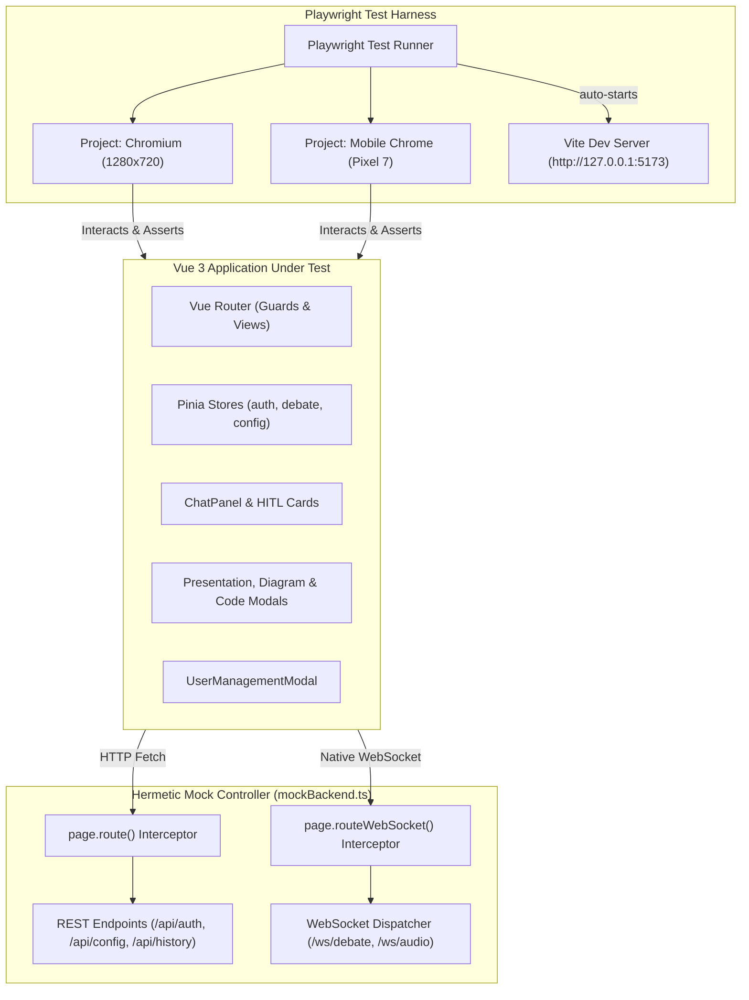

# Feature Specification (SDD): Playwright End-to-End (E2E) Testing Suite

## 1. Context & Problem Statement

ATENEA relies on a complex, multi-tiered frontend architecture built on Vue 3, Pinia, Tailwind CSS v4, and native WebSockets. While unit tests with Vitest and `@vue/test-utils` covered individual components, utilities, and Pinia stores (377 unit tests), there was a critical lack of automated **End-to-End (E2E)** validation across full browser lifecycles.

Key verification challenges that required E2E automation:
1. **Full Authentication & Route Guard Lifecycles:** Uninitialized backend redirects (`/setup`), role-based protection, token expiration handling, and route navigation guards preventing back-navigation to login when authenticated.
2. **Real-Time Streaming & WebSocket Interactions:** Asynchronous token streaming from supervisor and specialist agents (`/ws/debate`) and dynamic UI synchronization between the Agent Stage (ParticleOrb) and the Chat Panel.
3. **Human-in-the-Loop (HITL) Decision Flows:** Interactive intervention cards triggered mid-debate, verifying user approval, rejection, or retry actions and their corresponding WebSocket payloads.
4. **Rich Tool Modals & Interactive Artifacts:** Presentation slide navigation (keyboard arrows, slide counter, PPTX/HTML export), interactive Mermaid diagrams (zoom in/out/reset controls), and source code viewers.
5. **Cross-View Session Restoration:** Navigation between `/history` and `/`, ensuring session state, message threads, and HITL control states are cleanly restored without UI anomalies.
6. **Responsive Layouts:** Ensuring touch/mobile viewports (e.g. Pixel 7 / iPhone) maintain usable controls, floating scroll buttons, and accessible modals.

---

## 2. Architecture & Design Principles

### 2.1 Hermetic Testing with Network Interception
To make the E2E suite fast, fully deterministic, and runnable in CI/CD without active LLM credentials or an external database:
- **`mockBackend.ts`** provides a dedicated test fixture and mock controller.
- All HTTP API calls (`/api/auth/*`, `/api/config/*`, `/api/history/*`, `/api/observability/stats`, etc.) are intercepted with typed mock responses.
- WebSocket handshakes (`/ws/debate`) are intercepted via Playwright's `page.routeWebSocket()` API, providing programmatic helpers:
  - `sendStreamingAssistantMessage(text, agentRole)`
  - `sendHITLRequest(agentRole, prompt, proposedAction)`
  - `sendPresentation(markdownContent)`
  - `sendDiagram(mermaidContent)`
  - `sendCode(codeContent)`

### 2.2 Route Precedence & Fallback
Playwright matches route listeners in reverse order of definition (last defined is evaluated first). To ensure unhandled endpoints don't cause unintended 401 redirects (which trigger the global auth interceptor in `main.ts`):
1. A default catch-all fallback `*/**/api/**` returning `200 OK {}` is registered first.
2. Specific handlers (`/api/auth/status`, `/api/config/agents`, `/api/config/topology`, `/api/history/sessions`) are registered after so they take precedence.

### 2.3 Responsive & Cross-Device Coverage
The suite is configured in `playwright.config.ts` with two primary target devices:
- **Chromium Desktop**: Viewport `1280x720`, desktop mouse and keyboard interactions.
- **Mobile Chrome**: Emulated `Pixel 7` (`412x915`), touch-enabled, validating compact layouts and responsive element visibility.

---

## 3. Test Suites & Coverage Breakdown

The E2E suite is divided into 5 focused specification files in `frontend/e2e/`:

| Spec File | Focus Area | Key Scenarios Tested |
| :--- | :--- | :--- |
| **`auth.spec.ts`** | Authentication & Setup | - Uninitialized backend redirect to `/setup` - Admin account creation - Invalid login credentials error display - Valid login and redirection to dashboard - Header logout flow - Route guard preventing `/login` navigation when authenticated |
| **`chat-and-agents.spec.ts`** | Chat & Multi-Agent Debate | - Full dashboard component loading (Header, Stage, Chat, Input) - Specialist agent selector dropdown - User prompt submission and streaming response via WebSocket - HITL point-of-control decision card and approval/retry action - Dynamic scroll-to-top/bottom floating button visibility based on scroll position |
| **`tools-modals.spec.ts`** | Visual Tools & Modals | - Presentation modal: slide navigation via buttons and keyboard arrows, slide counter update (`1 / 3` -> `2 / 3`), export menu dropdown (PPTX, HTML) - Mermaid diagram modal: render, zoom in/out, zoom reset button - Code snippet modal: syntax display and clipboard copy button |
| **`history.spec.ts`** | Session History | - Navigating to `/history` and listing archived deliberations - Real-time text search filtering - Session restoration into chat, verifying HITL state remains cleanly closed - Session deletion with confirmation dialog (`window.confirm`) |
| **`user-management.spec.ts`** | User Administration | - Admin user opens user management modal and registers a new user with specific role - Standard (non-admin) user does not see user management option in header menu |

---

## 4. Design Decisions & Technical Refinements

1. **Decoupled Test IDs (`data-test` attributes):**
   - Added persistent `data-test` attributes to key interactive components (`session-card`, `delete-session-btn`, `history-search-input`, `zoom-reset-btn`, `slide-counter`, etc.) to decouple tests from localized text or CSS class changes.
2. **Event Deduplication in `PresentationModal.vue`:**
   - In `PresentationModal.vue`, both the `<dialog @keydown="handleKeyDown">` and `window.addEventListener('keydown', handleKeyDown)` could capture the same keypress during bubbling. Added `if (!props.isOpen || e.defaultPrevented) return` to eliminate double slide skipping upon keyboard navigation.
3. **Zoom Reset Button Accessibility in `DiagramModal.vue`:**
   - Refactored `zoom-reset-btn` from `hidden xs:inline-flex` (which relied on an undefined Tailwind breakpoint) to standard inline flex styling so zoom controls remain fully accessible across all viewports.
4. **Non-Blocking Unit Test Execution:**
   - Updated `package.json` scripts so that `"test:unit": "vitest run"` runs once by default in non-interactive environments, and added `"test:unit:watch": "vitest"` for live TDD development.

